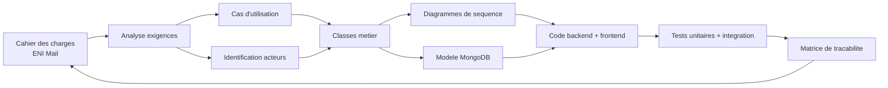

# 01 — Analyse et conception

## 1. Contexte

L'**École Nationale d'Informatique (ENI)**, école doctorale d'informatique de l'Université de Fianarantsoa (Madagascar), coordonne les communications entre étudiants, enseignants et personnel administratif au moyen d'outils hétérogènes :

- Emails institutionnels externes (Gmail, Outlook, Yahoo).
- Groupes WhatsApp spontanés.
- Affichages physiques et annonces de couloir.

Ces canaux présentent plusieurs faiblesses :

| Faiblesse | Conséquence |
|-----------|-------------|
| Centralisation inexistante | Les informations sont fragmentées, perdues au fil des migrations d'outils. |
| Traçabilité difficile | Impossible de prouver qu'une annonce officielle a été diffusée ou reçue. |
| Sécurité peu maîtrisée | Un compte Gmail compromis expose la correspondance institutionnelle. |
| Gouvernance déficiente | L'ENI ne contrôle pas le chiffrement, la rétention, les sauvegardes. |

## 2. Problématique

> **Comment doter l'ENI d'une plateforme de messagerie interne, contrôlée par l'établissement, traçable, sécurisée et utilisable par tous ses membres sans dépendre d'un serveur SMTP/IMAP externe ?**

## 3. Objectifs du projet

### Objectifs fonctionnels

1. Fournir un canal **interne** de messagerie entre membres de l'ENI (étudiants, enseignants, personnel, administrateurs).
2. Gérer des **groupes de diffusion** (classes, promotions, filières).
3. Offrir les fonctions attendues d'un client de messagerie moderne : composition, réponse, transfert, brouillons, pièces jointes, recherche.
4. Fournir un **espace d'administration** pour créer les comptes et consulter des statistiques d'usage.

### Objectifs non fonctionnels

1. **Sécurité** : authentification forte (JWT + refresh cookie HttpOnly), BCrypt pour les mots de passe, contrôle d'accès vérifié côté serveur, limitation du brute force.
2. **Performance** : temps de réponse < 2 s pour 100 à 500 utilisateurs.
3. **Maintenabilité** : séparation stricte contrôleur / service / repository / DTO.
4. **Portabilité** : ne dépend pas d'un service externe ; déployable sur un serveur ENI.
5. **Accessibilité** : interface responsive, contraste et navigation clavier.

### Hors périmètre (explicite)

- Chiffrement bout en bout entre utilisateurs (TLS en transport suffit pour la V1).
- Interopérabilité avec des serveurs SMTP/IMAP externes.
- Signature électronique des messages.
- Application mobile native (le web responsive couvre les écrans mobiles).

## 4. Acteurs

| Acteur | Description | Permissions principales |
|--------|-------------|-------------------------|
| **Étudiant** (`ROLE_ETUDIANT`) | Inscrit à l'ENI, rattaché à une filière et une promotion (ex. M1 GLBD). | Lire/envoyer des messages, répondre, transférer, gérer sa corbeille, consulter les groupes auxquels il appartient. |
| **Enseignant** (`ROLE_ENSEIGNANT`) | Membre du corps enseignant. | Idem étudiant + créer et gérer ses propres groupes, envoyer à des groupes de classes. |
| **Administrateur** (`ROLE_ADMIN`) | Membre de la DSI ou du personnel administratif habilité. | Idem enseignant + créer/désactiver des comptes, attribuer des rôles, gérer tous les groupes, consulter le tableau de bord. |
| **Système** (acteur système) | Exécute les traitements autonomes : seed initial, expiration des tokens, rotation du refresh. | — |

## 5. Exigences fonctionnelles (reliées au cahier des charges)

| Identifiant | Exigence | Statut | Référence code |
|------------|----------|:------:|-----------------|
| EF-01 | Connexion avec email + mot de passe | ✅ | [AuthController.login](../../eni-mail-back/src/main/java/mg/eni/email/controller/AuthController.java) |
| EF-02 | Déconnexion | ✅ | AuthController.logout |
| EF-03 | Authentification JWT + rafraîchissement | ✅ | [JwtService](../../eni-mail-back/src/main/java/mg/eni/email/security/JwtService.java) |
| EF-04 | Gestion des rôles (étudiant / enseignant / admin) | ✅ | [Role.java](../../eni-mail-back/src/main/java/mg/eni/email/enums/Role.java) |
| EF-05 | CRUD utilisateurs | ✅ | [UserController](../../eni-mail-back/src/main/java/mg/eni/email/controller/UserController.java) |
| EF-06 | Composer et envoyer un message | ✅ | MessageController.send |
| EF-07 | Ajouter plusieurs destinataires | ✅ | `ComposeMessageRequest.toUserIds[]` |
| EF-08 | Objet + corps | ✅ | `Message.subject`, `Message.body` |
| EF-09 | Brouillons | ✅ | `Message.draft`, `senderFolder=DRAFT` |
| EF-10 | Réponse et répondre à tous | ✅ | MessageController.reply, `replyAll` |
| EF-11 | Transfert | ✅ | MessageController.forward |
| EF-12 | Marquer lu / non lu | ✅ | `recipients[].read` |
| EF-13 | Suppression (corbeille) | ✅ | `recipients[].folder = TRASH` |
| EF-14 | Restauration | ✅ | MessageService.restore |
| EF-15 | Suppression définitive | ✅ | MessageService.deletePermanent |
| EF-16 | Dossiers (Inbox/Sent/Drafts/Trash) | ✅ | [MessageFolder.java](../../eni-mail-back/src/main/java/mg/eni/email/enums/MessageFolder.java) |
| EF-17 | Pièces jointes (upload, download, suppression) | ✅ | [AttachmentController](../../eni-mail-back/src/main/java/mg/eni/email/controller/AttachmentController.java) |
| EF-18 | Groupes (CRUD, membres) | ✅ | [GroupController](../../eni-mail-back/src/main/java/mg/eni/email/controller/GroupController.java) |
| EF-19 | Envoi à un groupe | ✅ | `ComposeMessageRequest.toGroupIds` |
| EF-20 | Recherche plein texte | ✅ | [SearchController](../../eni-mail-back/src/main/java/mg/eni/email/controller/SearchController.java) |
| EF-21 | Tableau de bord administrateur | ✅ | [AdminController](../../eni-mail-back/src/main/java/mg/eni/email/controller/AdminController.java) |
| EF-22 | Changement de mot de passe utilisateur | ✅ | UserController.changePassword |

## 6. Exigences non fonctionnelles

| Identifiant | Exigence | Statut |
|------------|----------|:------:|
| ENF-01 | Hachage BCrypt des mots de passe (facteur 12) | ✅ |
| ENF-02 | JWT HS256, secret ≥ 32 octets, access 15 min | ✅ |
| ENF-03 | Refresh token en cookie HttpOnly + SameSite=Lax + rotation | ✅ |
| ENF-04 | Rate-limit login (5 essais / 15 min) | ✅ |
| ENF-05 | CORS configuré précisément (origine front explicite) | ✅ |
| ENF-06 | Validation Jakarta Bean Validation côté API | ✅ |
| ENF-07 | Pagination côté serveur sur toutes les listes | ✅ |
| ENF-08 | Index MongoDB sur les champs filtrés (texte, recipients.userId, senderId, email) | ✅ |
| ENF-09 | Erreurs API uniformisées (`ApiErrorResponse`) | ✅ |
| ENF-10 | Tailles de fichier et types MIME bornés | ✅ (5 Mo max, liste blanche) |
| ENF-11 | UI responsive mobile ↔ desktop | ✅ |
| ENF-12 | Journalisation applicative structurée | ✅ (SLF4J + Logback) |
| ENF-13 | HTTPS en production | 📄 (documenté, à configurer au déploiement) |

## 7. Règles métier structurantes

| Identifiant | Règle | Illustrée dans |
|------------|-------|----------------|
| RM-01 | Un utilisateur ne peut pas s'attribuer lui-même `ROLE_ADMIN`. | `UserController.create` + `SecurityConfig` |
| RM-02 | Un administrateur ne peut pas se désactiver lui-même. | `UserService.disable` |
| RM-03 | L'état lu/supprimé d'un message est **indépendant par destinataire**. | Modèle `Message.recipients[]` |
| RM-04 | L'expéditeur dispose de son propre état (`senderFolder`, `senderDeleted`). | `Message` |
| RM-05 | La suppression définitive ne retire le document que si **plus aucun** utilisateur ne le voit. | `MessageService.deletePermanent` |
| RM-06 | Un étudiant ne peut pas créer ou éditer de groupe. | `GroupService.requireTeacherOrAdmin` |
| RM-07 | Un étudiant ne peut envoyer un message à un groupe que s'il en est membre. | `MessageService.checkGroupSendPermission` |
| RM-08 | Lors d'un envoi à plusieurs groupes et destinataires, les **doublons sont supprimés**. | `MessageService.buildMessage` |
| RM-09 | Un destinataire désactivé ne peut pas recevoir de message. | `MessageService.buildMessage` (vérif `AccountStatus.ACTIVE`) |
| RM-10 | Le propriétaire d'une pièce jointe ne peut la supprimer que si elle n'est pas rattachée à un message envoyé. | `AttachmentService.deleteOwn` |
| RM-11 | L'accès à une pièce jointe exige d'être propriétaire, expéditeur, destinataire, ou admin. | `AttachmentService.assertDownloadAccess` |

## 8. Contraintes techniques

- **Stack imposée** : Spring Boot 3.3.x LTS, Java 17+, React 18/19, Vite, Tailwind CSS v4, MongoDB 7.
- **Pas de SGBD relationnel** — modélisation NoSQL.
- **Secret JWT** à au moins 32 octets pour satisfaire HS256.
- **Pas de secret dans le code source** : variables d'environnement + `.env` ignoré par Git.

## 9. Hypothèses de conception

- **H1** : la volumétrie cible est de 100 à 500 utilisateurs et 100 à 1 000 messages par campagne (dimensionnement MongoDB single-node suffisant).
- **H2** : les destinataires embarqués dans le document `messages` (max 500 pour un gros groupe) restent sous la limite BSON de 16 Mo — vérifié : chaque sous-document pèse ~200 octets, donc un message avec 500 destinataires ≈ 100 Ko hors corps.
- **H3** : la V1 n'intègre pas de notifications push ni d'emails de rappel externes.
- **H4** : le stockage des pièces jointes est sur disque local du serveur ; migration vers GridFS ou S3 possible sans changement d'API (seul `AttachmentService` serait à réimplémenter).

## 10. Choix d'architecture et justifications

### 10.1. Architecture logique

**3-tiers** classique : SPA React ↔ API REST Spring Boot ↔ MongoDB.

- La SPA affiche l'interface et consomme l'API ; aucun rendu côté serveur, pour un déploiement statique simple.
- L'API applique **toutes** les règles métier et les contrôles d'accès (défense en profondeur : rien n'est délégué au front).
- MongoDB stocke les données ; les pièces jointes résident sur le filesystem du serveur backend.

### 10.2. Authentification JWT + refresh cookie

| Choix | Justification |
|-------|---------------|
| **Access token JWT** 15 min, en mémoire côté front | Minimise la surface d'exposition en cas de XSS. |
| **Refresh token** 7 j en cookie HttpOnly + SameSite=Lax | Non lisible par JS, immunisé au XSS ; rotation à chaque usage. |
| Détection de réutilisation de refresh | Révoque tous les refresh d'un utilisateur si un token révoqué est présenté — mitigation du vol. |

### 10.3. Destinataires embarqués dans `messages.recipients[]`

**Pourquoi embedded plutôt qu'une collection `message_recipients` ?**

- Les lectures « boîte de réception d'un utilisateur » demandent un seul index composé `{recipients.userId, recipients.folder, sentAt}` → performance linéaire sans jointure.
- L'état lu/supprimé est **toujours lu avec le message**, jamais isolément : la colocation BSON est optimale.
- La taille maximale d'un sous-document reste largement sous la limite BSON (cf. H2).

### 10.4. Architecture en couches côté backend

```
controller/   →  service/   →  repository/   →  MongoDB
    ↑              ↑               ↑
   DTO         Exception       MongoTemplate pour les mises
                                a jour atomiques (array filters)
```

- Les contrôleurs ne contiennent **aucune logique métier**, seulement la traduction HTTP ↔ DTO.
- Les services sont transactionnels logiques et encapsulent les règles métier.
- Les repositories étendent `MongoRepository` + une interface custom pour les opérations complexes (`MessageRepositoryCustom`).

### 10.5. Gestion des exceptions

Un `@RestControllerAdvice` global convertit toutes les exceptions en `ApiErrorResponse` uniformes :

```json
{
  "timestamp": "...",
  "status": 403,
  "error": "Forbidden",
  "code": "MESSAGE_ACCESS_DENIED",
  "message": "Vous n'avez pas acces a ce message",
  "path": "/api/messages/..."
}
```

Ces codes applicatifs sont stables et indépendants des exceptions internes, ce qui simplifie l'UI (toasts mappés sur `code`).

---

## 11. Diagramme global de conception



Ce cycle illustre la boucle de vérification : chaque exigence du cahier des charges est tracée jusqu'à son implémentation et son test (voir [13-matrice-tracabilite.md](13-matrice-tracabilite.md)).

---

## 12. Suite logique

→ [02-diagramme-cas-utilisation.md](02-diagramme-cas-utilisation.md) — cartographie fonctionnelle par acteur.
