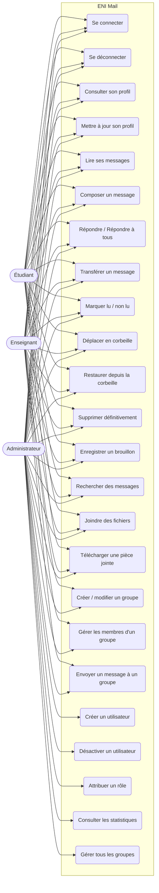

# Diagramme de cas d'utilisation — ENI Mail

## Règles d'accès résumées

| Cas d'utilisation | Étudiant | Enseignant | Administrateur |
|---|:---:|:---:|:---:|
| Messagerie standard (envoyer, lire, répondre, rechercher) | OK | OK | OK |
| Créer / éditer un groupe | — | OK | OK |
| Envoi à un groupe | — | OK (ses groupes) | OK (tous) |
| Gestion des utilisateurs | — | — | OK |
| Attribution des rôles | — | — | OK |
| Tableau de bord statistiques | — | — | OK |
