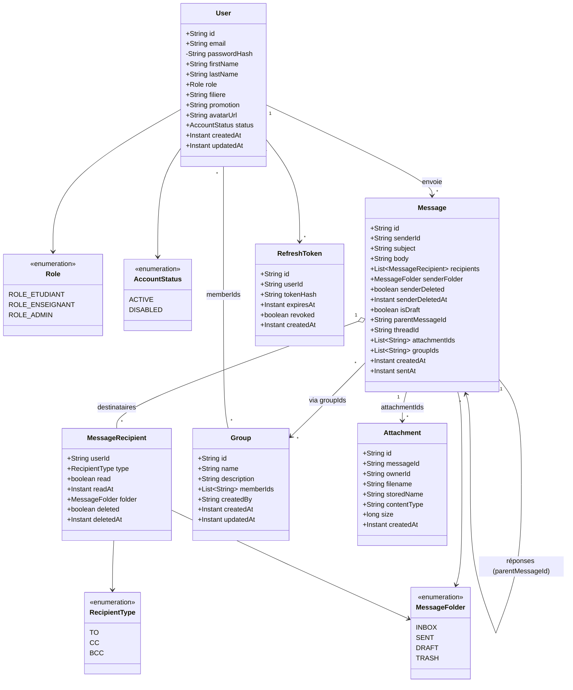

# Diagramme de classes (modèle métier) — ENI Mail

## Invariants métier principaux

1. `passwordHash` n'est jamais exposé dans un DTO de réponse.
2. Un `User` ne peut pas s'attribuer lui-même `ROLE_ADMIN`.
3. Un `Message` avec `isDraft = true` n'a pas de `sentAt` et n'apparaît dans aucun `recipients[].folder` tant qu'il n'est pas envoyé.
4. L'état lu/supprimé d'un destinataire est indépendant des autres destinataires.
5. L'expéditeur dispose de son propre `senderFolder` et `senderDeleted` indépendants.
6. Les `attachmentIds` et `groupIds` référencent uniquement des entités existantes (vérifié au service).
