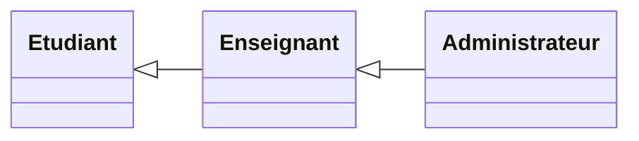

# 02 — Diagramme de cas d'utilisation

## 1. Introduction

Ce document présente les **cas d'utilisation** du système ENI Mail, selon la vue UML 2.5 des *Use Cases*. Il est structuré en trois parties :

1. Le **diagramme global** acteurs ↔ cas d'utilisation.
2. Un tableau récapitulatif des **permissions par acteur**.
3. Les **fiches textuelles détaillées** de chaque cas d'utilisation (identifiant, préconditions, scénario nominal, alternatifs, exceptions, postconditions).

---

## 2. Diagramme global

```mermaid
flowchart LR
    Student((Étudiant))
    Teacher((Enseignant))
    Admin((Administrateur))
    System((Système))

    subgraph ENIMail["Système ENI Mail"]
        direction TB
        UC01[UC-01 Se connecter]
        UC02[UC-02 Se déconnecter]
        UC03[UC-03 Rafraîchir le token]
        UC04[UC-04 Consulter son profil]
        UC05[UC-05 Modifier son profil]
        UC06[UC-06 Changer son mot de passe]

        UC10[UC-10 Composer un message]
        UC11[UC-11 Ajouter des destinataires]
        UC12[UC-12 Envoyer un message]
        UC13[UC-13 Enregistrer un brouillon]
        UC14[UC-14 Lire un message]
        UC15[UC-15 Répondre]
        UC16[UC-16 Répondre à tous]
        UC17[UC-17 Transférer]
        UC18[UC-18 Marquer lu / non lu]
        UC19[UC-19 Déplacer à la corbeille]
        UC20[UC-20 Restaurer depuis la corbeille]
        UC21[UC-21 Supprimer définitivement]
        UC22[UC-22 Rechercher un message]

        UC30[UC-30 Attacher un fichier]
        UC31[UC-31 Télécharger une pièce jointe]
        UC32[UC-32 Supprimer une pièce jointe]

        UC40[UC-40 Consulter la liste des groupes]
        UC41[UC-41 Créer un groupe]
        UC42[UC-42 Modifier un groupe]
        UC43[UC-43 Ajouter des membres]
        UC44[UC-44 Retirer un membre]
        UC45[UC-45 Supprimer un groupe]
        UC46[UC-46 Envoyer un message à un groupe]

        UC50[UC-50 Créer un utilisateur]
        UC51[UC-51 Modifier un utilisateur]
        UC52[UC-52 Désactiver un utilisateur]
        UC53[UC-53 Attribuer un rôle]
        UC54[UC-54 Consulter le tableau de bord]

        UC90[UC-90 Seed initial des comptes]
        UC91[UC-91 Rotation / révocation refresh]
    end

    Student --> UC01 & UC02 & UC03 & UC04 & UC05 & UC06
    Student --> UC10 & UC11 & UC12 & UC13 & UC14 & UC15 & UC16 & UC17 & UC18 & UC19 & UC20 & UC21 & UC22
    Student --> UC30 & UC31 & UC32
    Student --> UC40 & UC46

    Teacher --> UC01 & UC02 & UC03 & UC04 & UC05 & UC06
    Teacher --> UC10 & UC11 & UC12 & UC13 & UC14 & UC15 & UC16 & UC17 & UC18 & UC19 & UC20 & UC21 & UC22
    Teacher --> UC30 & UC31 & UC32
    Teacher --> UC40 & UC41 & UC42 & UC43 & UC44 & UC45 & UC46

    Admin --> UC01 & UC02 & UC03 & UC04 & UC05 & UC06
    Admin --> UC10 & UC11 & UC12 & UC13 & UC14 & UC15 & UC16 & UC17 & UC18 & UC19 & UC20 & UC21 & UC22
    Admin --> UC30 & UC31 & UC32
    Admin --> UC40 & UC41 & UC42 & UC43 & UC44 & UC45 & UC46
    Admin --> UC50 & UC51 & UC52 & UC53 & UC54

    System --> UC90 & UC91
```

### Relations UML employées

- **Association** : lien direct acteur → cas d'utilisation (trait plein ci-dessus).
- **Include** : UC-11 (Ajouter destinataires) est *inclus* dans UC-12 (Envoyer). UC-30 (Attacher fichier) est inclus dans UC-13 et UC-12 quand le brouillon contient une pièce jointe.
- **Extend** : UC-16 (Répondre à tous) *étend* UC-15 (Répondre) avec pour point d'extension « destinataires à inclure ».
- **Généralisation entre acteurs** : `Administrateur` hérite de `Enseignant` qui hérite de `Étudiant`, en termes de permissions.

---

## 3. Permissions synthétiques

| Fonctionnalité | Étudiant | Enseignant | Admin |
|----------------|:--------:|:----------:|:-----:|
| Messagerie standard | ✅ | ✅ | ✅ |
| Envoi à un groupe (membre) | ✅ | ✅ | ✅ |
| Envoi à un groupe (non membre) | ❌ | ✅ | ✅ |
| Créer / modifier un groupe | ❌ | ✅ (ses groupes) | ✅ (tous) |
| Supprimer un groupe | ❌ | ✅ (ses groupes) | ✅ |
| Gérer les comptes | ❌ | ❌ | ✅ |
| Attribuer un rôle | ❌ | ❌ | ✅ |
| Tableau de bord statistiques | ❌ | ❌ | ✅ |

---

## 4. Fiches textuelles détaillées

> Format : **ID** · **Nom** · **Acteur principal** · **Préconditions** · **Scénario nominal** · **Alternatifs** · **Exceptions** · **Postconditions**.

### UC-01 — Se connecter

- **Acteur principal** : Étudiant / Enseignant / Administrateur.
- **Préconditions** : compte existe, statut `ACTIVE`, utilisateur non actuellement authentifié dans ce navigateur.
- **Scénario nominal** :
  1. L'utilisateur ouvre l'application.
  2. Le système affiche le formulaire de connexion (`LoginPage`).
  3. L'utilisateur saisit son email et son mot de passe.
  4. Le système valide, génère un **access token** et un **refresh token**, pose le cookie `eni_refresh`.
  5. L'utilisateur est redirigé vers la boîte de réception.
- **Alternatifs** :
  - A1 (refresh silencieux) : au chargement, si un cookie valide existe, le système rafraîchit automatiquement sans écran de connexion.
- **Exceptions** :
  - E1 (identifiants invalides) : réponse 401 `BAD_CREDENTIALS`, message FR, compteur incrémenté.
  - E2 (compte désactivé) : 401, idem.
  - E3 (trop de tentatives) : 429 `TOO_MANY_REQUESTS`, verrouillage 15 min.
- **Postconditions** : utilisateur authentifié, SecurityContext initialisé, state front `user` défini.

### UC-02 — Se déconnecter

- **Acteur** : utilisateur authentifié.
- **Préconditions** : cookie `eni_refresh` présent.
- **Scénario nominal** : clic sur « Se déconnecter » → `POST /api/auth/logout` → révocation du refresh en base + cookie vidé → redirection vers `/login`.
- **Exceptions** : E1 (pas de cookie) → la déconnexion est idempotente (204).
- **Postconditions** : le refresh token stocké est marqué `revoked=true`, SecurityContext vidé.

### UC-03 — Rafraîchir le token

- **Acteur** : utilisateur (déclenchement automatique par l'intercepteur Axios).
- **Préconditions** : cookie `eni_refresh` valide et non révoqué.
- **Scénario nominal** :
  1. L'intercepteur détecte un 401 sur un appel protégé.
  2. Il émet `POST /api/auth/refresh`.
  3. Le backend valide le refresh, le révoque, en émet un nouveau (rotation).
  4. Nouveau access token renvoyé, requête initiale rejouée.
- **Exceptions** :
  - E1 (refresh révoqué) : tous les refresh de l'utilisateur sont invalidés (détection de vol).
  - E2 (refresh expiré) : 401 → front déconnecte l'utilisateur.
- **Postconditions** : nouveau couple de tokens, ancien refresh révoqué.

### UC-04 — Consulter son profil

- **Acteur** : utilisateur authentifié.
- **Scénario** : `GET /api/users/me` renvoie le DTO profil (sans `passwordHash`).

### UC-05 — Modifier son profil

- **Acteur** : utilisateur authentifié.
- **Scénario** : `PATCH /api/users/me` avec `firstName`, `lastName`, `filiere`, `promotion`, `avatarUrl`.
- **Postconditions** : document `User` mis à jour, `updatedAt` rafraîchi.

### UC-06 — Changer son mot de passe

- **Acteur** : utilisateur authentifié.
- **Scénario nominal** : saisie ancien + nouveau mot de passe → vérification BCrypt → hachage et sauvegarde.
- **Exceptions** : E1 ancien mot de passe erroné → 400 `BAD_CURRENT_PASSWORD`.
- **Postconditions** : `passwordHash` mis à jour ; les refresh tokens existants restent valides (choix V1).

### UC-10 — Composer un message

- **Acteur** : utilisateur authentifié.
- **Préconditions** : être connecté.
- **Scénario** : clic « Nouveau message » → ouverture de `ComposePage` → saisie objet, corps, destinataires.

### UC-11 — Ajouter des destinataires (*include* dans UC-12/UC-13*)*

- **Acteur** : utilisateur.
- **Scénario** : saisie dans le `RecipientPicker` → requête `GET /api/users?q=` et `GET /api/groups` → sélection → ajout aux listes `toUserIds` / `toGroupIds`.

### UC-12 — Envoyer un message

- **Acteur** : utilisateur authentifié.
- **Préconditions** : au moins un destinataire (ou groupe), un objet non vide.
- **Scénario nominal** :
  1. `POST /api/messages` avec le corps JSON.
  2. Le backend expande les groupes en user IDs, dédoublonne, supprime l'expéditeur de la liste.
  3. Il vérifie que chaque destinataire existe et est `ACTIVE`.
  4. Il construit `Message` avec `draft=false`, `sentAt=now`, `senderFolder=SENT`.
  5. Il rattache les `attachmentIds` au message (via `messageId`).
  6. 201 Created + `MessageDto`.
- **Alternatifs** :
  - A1 (brouillon → envoi) : la même requête met `draft=false` et `sentAt=now` sur un draft existant via `PUT /api/messages/drafts/{id}`.
- **Exceptions** :
  - E1 (aucun destinataire) : 400 `NO_RECIPIENT`.
  - E2 (destinataire introuvable) : 404 `RECIPIENT_NOT_FOUND`.
  - E3 (destinataire désactivé) : 409 `RECIPIENT_DISABLED`.
  - E4 (étudiant envoie à un groupe dont il n'est pas membre) : 403 `GROUP_SEND_FORBIDDEN`.
- **Postconditions** : message persisté, pièces jointes rattachées, dossiers mis à jour pour l'expéditeur et les destinataires.

### UC-13 — Enregistrer un brouillon

- **Acteur** : utilisateur.
- **Scénario** : `POST /api/messages` avec `asDraft:true`, ou `PUT /api/messages/drafts/{id}`.
- **Postconditions** : `Message.draft=true`, `senderFolder=DRAFT`, `sentAt=null`, aucun destinataire n'a le message en boîte de réception.

### UC-14 — Lire un message

- **Acteur** : expéditeur ou destinataire.
- **Préconditions** : être l'expéditeur, un destinataire ou un admin.
- **Scénario nominal** :
  1. `GET /api/messages/{id}`.
  2. `MessageService.assertCanAccess` vérifie les droits.
  3. Si l'utilisateur est destinataire, `recipients.$.read=true` est posé (idempotent).
  4. Retour `MessageDto`.
- **Exceptions** : E1 non autorisé → 403 `MESSAGE_ACCESS_DENIED`.
- **Postconditions** : état lu mis à jour pour ce destinataire uniquement.

### UC-15 — Répondre

- **Acteur** : utilisateur ayant accès au message parent.
- **Scénario** : `POST /api/messages/{id}/reply` avec le corps + `replyAll:false`. L'objet est préfixé `Re:`, `parentMessageId` et `threadId` propagés.

### UC-16 — Répondre à tous (*extend* UC-15)

- **Scénario** : identique mais `replyAll:true` → le backend inclut tous les destinataires `TO`/`CC` du parent (hors `BCC` et hors expéditeur courant).

### UC-17 — Transférer

- **Acteur** : utilisateur ayant accès au message parent.
- **Scénario** : `POST /api/messages/{id}/forward` avec nouveau(x) destinataire(s), le corps inclut le message original cité.

### UC-18 — Marquer lu / non lu

- **Acteur** : destinataire.
- **Scénario** : `PATCH /api/messages/{id}/read?read=true|false` → mise à jour atomique de `recipients.$.read` pour cet utilisateur uniquement.
- **Exception** : E1 non destinataire → 403 `NOT_RECIPIENT`.

### UC-19 — Déplacer à la corbeille

- **Acteur** : expéditeur ou destinataire.
- **Scénario** :
  - Si expéditeur : `senderFolder=TRASH`, `senderDeleted=true`.
  - Si destinataire : `recipients.$.folder=TRASH`, `recipients.$.deleted=true`.
- **Règle métier** : indépendant par acteur (RM-03, RM-04).

### UC-20 — Restaurer depuis la corbeille

- **Acteur** : utilisateur ayant déplacé le message.
- **Scénario** : `POST /api/messages/{id}/restore` → `folder=INBOX` ou `SENT` selon le rôle.

### UC-21 — Supprimer définitivement

- **Acteur** : utilisateur.
- **Scénario** : `DELETE /api/messages/{id}/permanent` → marque comme supprimé ; si plus aucun utilisateur ne voit le message, le document est effacé de la collection.

### UC-22 — Rechercher

- **Acteur** : utilisateur authentifié.
- **Scénario** : `GET /api/search?q=...&page=0` → index texte MongoDB sur `subject` + `body`, résultats filtrés par accès (expéditeur ou destinataire).

### UC-30 — Attacher un fichier

- **Acteur** : utilisateur (pendant la composition).
- **Scénario nominal** : `POST /api/attachments` (multipart) → validation taille/MIME → stockage disque sous UUID → `AttachmentDto`.
- **Exceptions** :
  - E1 (> 5 Mo) : 413 `FILE_TOO_LARGE`.
  - E2 (MIME non autorisé) : 415 `MIME_NOT_ALLOWED`.
  - E3 (path traversal) : 400 `INVALID_FILENAME`.

### UC-31 — Télécharger une pièce jointe

- **Scénario** : `GET /api/attachments/{id}` avec access token → `AttachmentService.assertDownloadAccess` → streaming du fichier avec `Content-Disposition`.

### UC-32 — Supprimer une pièce jointe

- **Préconditions** : la pièce jointe n'est pas attachée à un message déjà envoyé (brouillon uniquement).
- **Scénario** : `DELETE /api/attachments/{id}` → suppression disque + base.
- **Exception** : E1 (attachée à un envoi) → 409 `ATTACHMENT_LOCKED`.

### UC-40 — Lister les groupes

- **Acteur** : utilisateur authentifié.
- **Scénario** :
  - Étudiant : ne voit **que** les groupes dont il est membre.
  - Enseignant / Admin : voit tous les groupes.

### UC-41 — Créer un groupe

- **Acteur** : enseignant ou admin.
- **Scénario** : `POST /api/groups` avec `name`, `description`, `memberIds[]`.
- **Exceptions** : E1 (nom déjà pris) → 409 `GROUP_NAME_TAKEN`.
- **Postconditions** : groupe créé, `createdBy=currentUser`.

### UC-42 à UC-45 — Modifier / membres / supprimer

- **Acteur autorisé** : admin, ou enseignant **créateur** du groupe uniquement.
- **Endpoints** : `PATCH /api/groups/{id}`, `POST /api/groups/{id}/members`, `DELETE /api/groups/{id}/members/{uid}`, `DELETE /api/groups/{id}`.

### UC-46 — Envoyer à un groupe

- **Scénario** : `POST /api/messages` avec `toGroupIds[]` → `GroupService` résout les membres, `MessageService` fusionne et dédoublonne avec `toUserIds`.
- **Exception** : étudiant non membre → 403.

### UC-50 — Créer un utilisateur (admin)

- **Acteur** : admin.
- **Scénario** : `POST /api/users` avec email, password initial, role, filiere, promotion.
- **Exceptions** : E1 (email déjà pris) → 409 `EMAIL_ALREADY_USED`.

### UC-51 — Modifier un utilisateur (admin)

- **Scénario** : `PATCH /api/users/{id}`.

### UC-52 — Désactiver un utilisateur

- **Scénario** : `DELETE /api/users/{id}` → `status=DISABLED`.
- **Exception** : E1 (admin se désactive lui-même) → 403 `CANNOT_DISABLE_SELF`.

### UC-53 — Attribuer un rôle

- **Scénario** : UC-51 en changeant le champ `role`.
- **Règle** : un utilisateur n'est jamais capable de se promouvoir admin (RM-01).

### UC-54 — Consulter le tableau de bord

- **Acteur** : admin.
- **Scénario** : `GET /api/admin/stats` → agrégations MongoDB (comptes par rôle, nb messages non-brouillon, nb groupes, utilisateurs actifs).

### UC-90 — Seed initial (acteur système)

- **Déclencheur** : premier démarrage du backend en profil `dev`.
- **Scénario** : `DataInitializer.run` crée 7 comptes de démonstration si la collection `users` est vide.

### UC-91 — Rotation / révocation refresh

- **Déclencheur** : chaque appel à `/api/auth/refresh`.
- **Scénario** : révoque l'ancien refresh, en émet un nouveau, détecte la réutilisation.

---

## 5. Suite

→ [03-diagramme-classes.md](03-diagramme-classes.md) — vue structurelle des entités mobilisées dans ces cas d'usage.
