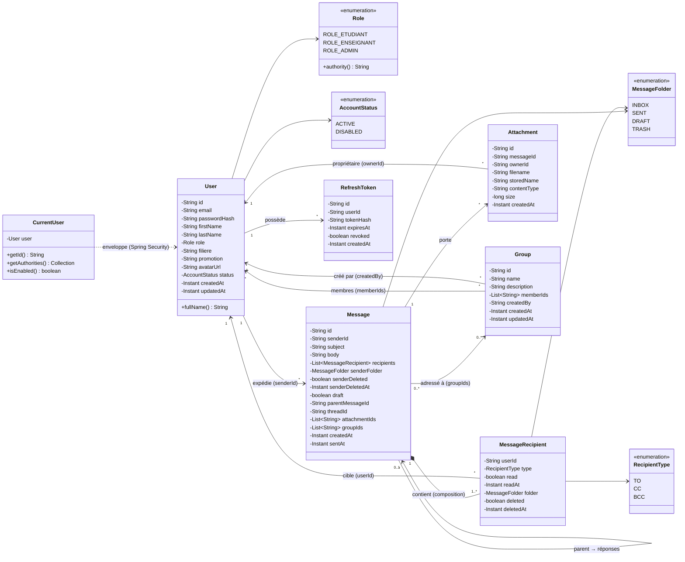
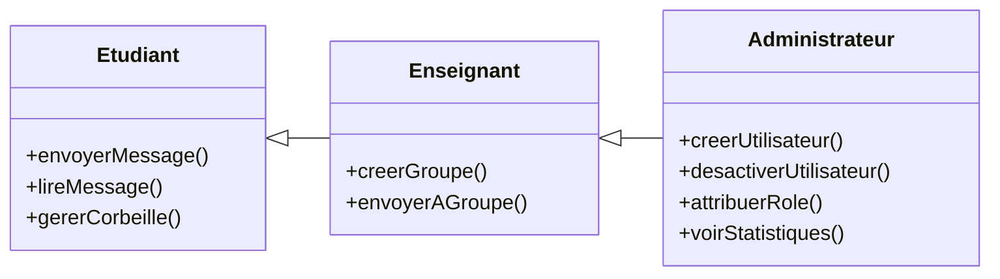

# 03 — Diagramme de classes

## 1. Introduction

Ce document présente le **modèle métier** d'ENI Mail sous forme UML 2.5. Il n'est **pas** un schéma relationnel : les entités `Message` et `Recipient` sont embarquées dans MongoDB (cf. [11-modele-donnees-mongodb.md](11-modele-donnees-mongodb.md)), ce qui est représenté ici par une **composition** forte.

Le modèle objet est volontairement maintenu aligné sur les documents Spring Data MongoDB pour garantir la traçabilité. Les attributs privés sont encapsulés par Lombok (`@Data`) ; les méthodes publiques listées sont celles de la couche service.

---

## 2. Diagramme de classes complet

---

## 3. Détail des classes

### 3.1. `User` — utilisateur de l'ENI

| Attribut | Type | Rôle |
|----------|------|------|
| `id` | String (ObjectId) | Identifiant unique MongoDB. |
| `email` | String (**unique**, index) | Identifiant de connexion. |
| `passwordHash` | String | BCrypt(12). **Jamais exposé par un DTO**. |
| `firstName`, `lastName` | String | Nom affiché. |
| `role` | `Role` | Rôle principal. |
| `filiere`, `promotion` | String (index) | Métadonnées pédagogiques. |
| `avatarUrl` | String? | Lien vers l'avatar. |
| `status` | `AccountStatus` | ACTIVE / DISABLED. |
| `createdAt`, `updatedAt` | Instant | Audit Spring Data. |

**Méthode** : `fullName()` concatène prénom + nom.

**Source** : [User.java](../../eni-mail-back/src/main/java/mg/eni/email/document/User.java)

### 3.2. `Message` — unité de communication

Contient le **texte** du message, ses **métadonnées** et une **liste composite** de `MessageRecipient`. La composition exprime que les destinataires n'ont pas d'existence hors du message qui les contient.

| Attribut | Type | Rôle |
|----------|------|------|
| `senderId` | String (index) | Référence au `User` expéditeur. |
| `subject` | String (text index poids 2) | Objet du mail. |
| `body` | String (text index) | Corps brut texte (markdown futur). |
| `recipients` | List<`MessageRecipient`> | État individuel par destinataire. |
| `senderFolder` | `MessageFolder` | SENT, DRAFT ou TRASH côté expéditeur. |
| `senderDeleted` | boolean | Vu par l'expéditeur dans sa corbeille ? |
| `draft` | boolean (index) | True tant que non envoyé. |
| `parentMessageId` | String? | Lien conversation (réponse). |
| `threadId` | String? (index) | Identifiant de fil (parent racine). |
| `attachmentIds` | List<String> | Références aux `Attachment`. |
| `groupIds` | List<String> | Groupes qui ont contribué à la liste finale. |
| `sentAt` | Instant? | Null si brouillon. |

**Index composés** : voir [Message.java](../../eni-mail-back/src/main/java/mg/eni/email/document/Message.java) et le fichier 11.

### 3.3. `MessageRecipient` — vue d'un destinataire

Classe **embarquée** (pas de collection propre). L'ensemble de ces objets représente les « vues » qu'ont les destinataires du même message.

| Attribut | Rôle |
|----------|------|
| `userId` | Référence au destinataire. |
| `type` | TO, CC ou BCC. |
| `read` + `readAt` | État de lecture **spécifique à ce destinataire**. |
| `folder` | INBOX ou TRASH pour ce destinataire. |
| `deleted` + `deletedAt` | Suppression individuelle. |

**Pourquoi embarqué ?** Chaque destinataire a un état propre, mais cet état est **toujours** lu au même moment que le message. Colocation BSON → performance maximale.

### 3.4. `Attachment` — pièce jointe

| Attribut | Rôle |
|----------|------|
| `messageId` | Null tant que la PJ est flottante (en cours de rédaction). |
| `ownerId` | L'utilisateur qui a uploadé. |
| `filename` | Nom original nettoyé (`StringUtils.cleanPath`). |
| `storedName` | UUID + extension, nom réel sur disque. |
| `contentType`, `size` | Métadonnées. |

### 3.5. `Group` — groupe de diffusion

| Attribut | Rôle |
|----------|------|
| `name` | Nom unique (index unique). |
| `description` | Facultatif. |
| `memberIds` | Références aux utilisateurs membres. |
| `createdBy` | Auteur du groupe. |

### 3.6. `RefreshToken` — jeton de rafraîchissement

| Attribut | Rôle |
|----------|------|
| `userId` | Propriétaire. |
| `tokenHash` | SHA-256 du JWT (le JWT en clair n'est jamais stocké). |
| `expiresAt` | Expiration (7 j par défaut). |
| `revoked` | True si logout, rotation, ou détection de réutilisation. |

### 3.7. `CurrentUser` — adaptateur Spring Security

Implémente `UserDetails` et encapsule un `User` métier. Produit par `CustomUserDetailsService` pour les besoins de la chaîne Spring Security.

---

## 4. Associations détaillées

| Source | Multiplicité | Destination | Sémantique | Implémentation |
|--------|:---:|-------------|------------|----------------|
| `Message` | 1 — 1..* | `MessageRecipient` | **Composition** : les destinataires n'existent qu'au sein du message. | Liste embarquée BSON. |
| `User` | 1 — 0..* | `Message` | Un utilisateur expédie plusieurs messages. | Référence `senderId`. |
| `User` | 1 — 0..* | `MessageRecipient` | Un utilisateur est destinataire de plusieurs messages. | Référence `userId`. |
| `Message` | 0..1 — 0..* | `Message` | Un message peut avoir un parent (réponse/transfert). | `parentMessageId`. |
| `Message` | 0..* — 0..* | `Group` | Un message peut avoir ciblé plusieurs groupes. | `groupIds`. |
| `Group` | * — * | `User` | Appartenance aux groupes. | `memberIds`. |
| `Message` | 1 — 0..* | `Attachment` | PJs d'un message. | `attachmentIds` (côté message) + `messageId` (côté PJ). |
| `User` | 1 — 0..* | `RefreshToken` | Historique de refresh (rotation). | `userId`. |

### Pourquoi deux références `Message` ↔ `Attachment` ?

- **Côté message** : `attachmentIds` permet de lister rapidement les PJ d'un message.
- **Côté PJ** : `messageId` sert au contrôle d'accès inverse (puis-je accéder à cette PJ ? qui est destinataire du message ?).

---

## 5. Hiérarchie de rôles (généralisation)

Bien que `Role` soit un enum (pas une hiérarchie Java), les **permissions** sont hiérarchiques :

Cette hiérarchie est **implémentée** par les vérifications `if (role == ROLE_ADMIN) return;` dans les services (défense explicite, pas d'héritage d'objet).

---

## 6. Invariants métier (contraintes de classe)

| Invariant | Classe(s) | Garantie |
|-----------|-----------|----------|
| I-1 : `User.email` est unique. | `User` | Index unique MongoDB. |
| I-2 : `User.passwordHash` jamais null. | `User` | Contrôle dans `UserService.create`. |
| I-3 : `User.role != null`. | `User` | Validation Jakarta sur `CreateUserRequest`. |
| I-4 : `Message.recipients` non vide si `draft=false`. | `Message` | `MessageService.buildMessage`. |
| I-5 : `Message.sentAt != null` ⇔ `draft = false`. | `Message` | Propriété de la construction. |
| I-6 : les `userId` dans `recipients` sont deux à deux distincts. | `Message` | `LinkedHashSet` lors de la construction. |
| I-7 : `RefreshToken.tokenHash` est unique. | `RefreshToken` | Index unique MongoDB. |
| I-8 : un `Group.name` est unique (casse insensible). | `Group` | Vérifié dans le service. |

---

## 7. Choix de modélisation MongoDB vs UML classique

- **Pas de table `message_recipients`** : contrairement à un modèle relationnel, on ne crée pas d'entité liée pour chaque destinataire. L'embedding reflète une classe **composite**, cohérente avec le pattern UML de composition.
- **Pas d'objet `Thread`** : la notion de conversation est portée par `threadId` (identifiant du message racine), pas par une entité dédiée.
- **`groupIds` historique** : on conserve la trace des groupes d'origine même si leur composition change ultérieurement.

---

## 8. Classes de service (vue simplifiée)

Pour référence croisée avec les diagrammes de séquence (fichier 05) :

```mermaid
classDiagram
    class AuthService {
        +login(email, password) AuthResult
        +refresh(rawRefreshToken) AuthResult
        +logout(rawRefreshToken)
    }
    class UserService {
        +getById(id) User
        +create(req) User
        +updateAsAdmin(id, req) User
        +updateProfile(id, req) User
        +changePassword(id, req)
        +disable(id, actingId)
    }
    class MessageService {
        +send(req, sender) MessageDto
        +updateDraft(id, req, sender) MessageDto
        +reply(parentId, req, sender) MessageDto
        +forward(parentId, req, sender) MessageDto
        +markRead(id, user, read)
        +moveToTrash(id, user)
        +restore(id, user)
        +deletePermanent(id, user)
        +listFolder(folder, user, pageable) Page
        +counts(user) FolderCountsDto
        +getOne(id, user) MessageDto
    }
    class GroupService {
        +list(user, query, pageable) Page
        +create(req, user) Group
        +update(id, req, user) Group
        +delete(id, user)
        +addMembers(id, ids, user) Group
        +removeMember(id, uid, user) Group
    }
    class AttachmentService {
        +upload(file, owner) Attachment
        +download(id, user) DownloadResource
        +deleteOwn(id, user)
    }
    class AdminStatsService {
        +build() AdminStatsDto
    }
    class JwtService {
        +generateAccessToken(user) String
        +generateRefreshToken(user) String
        +parse(token) Claims
        +parseOfType(token, type) Claims
    }
    class LoginAttemptService {
        +isBlocked(key) boolean
        +onSuccess(key)
        +onFailure(key)
    }
```

---

## 9. Suite

→ [04-diagramme-objets.md](04-diagramme-objets.md) — instanciation concrète de ce modèle.
