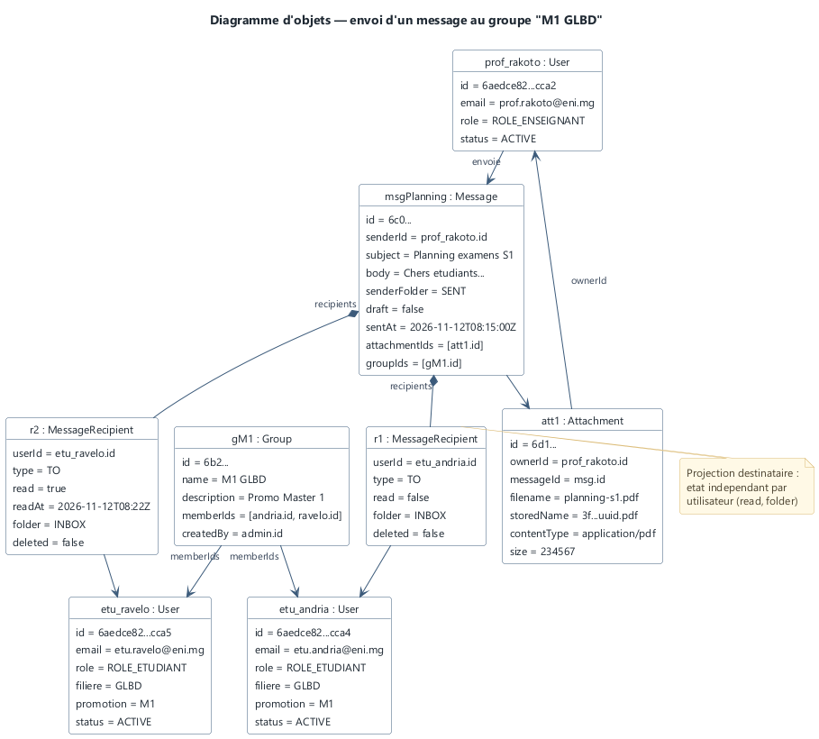
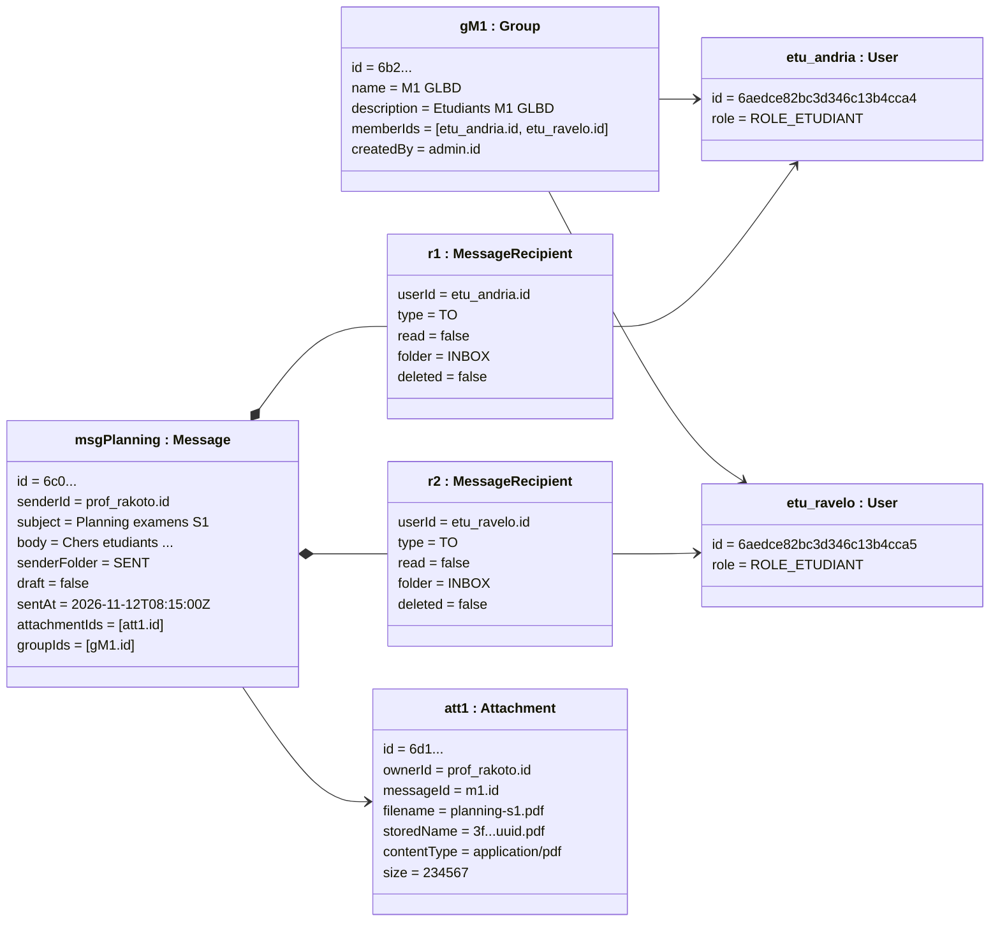
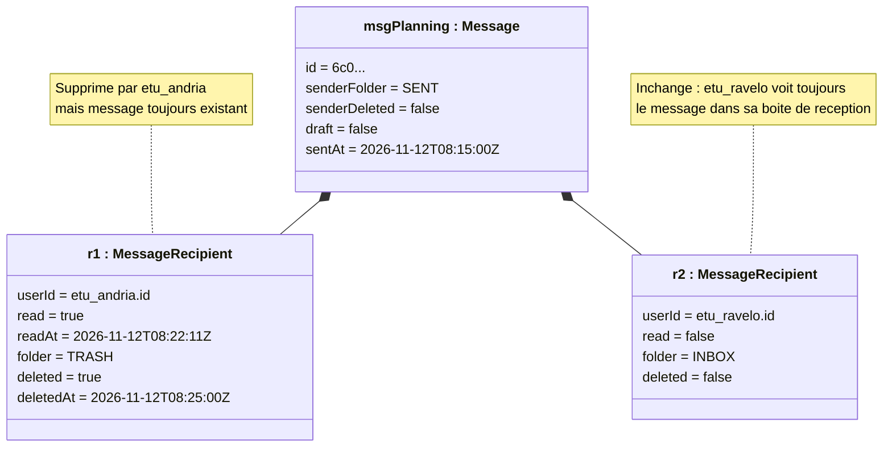
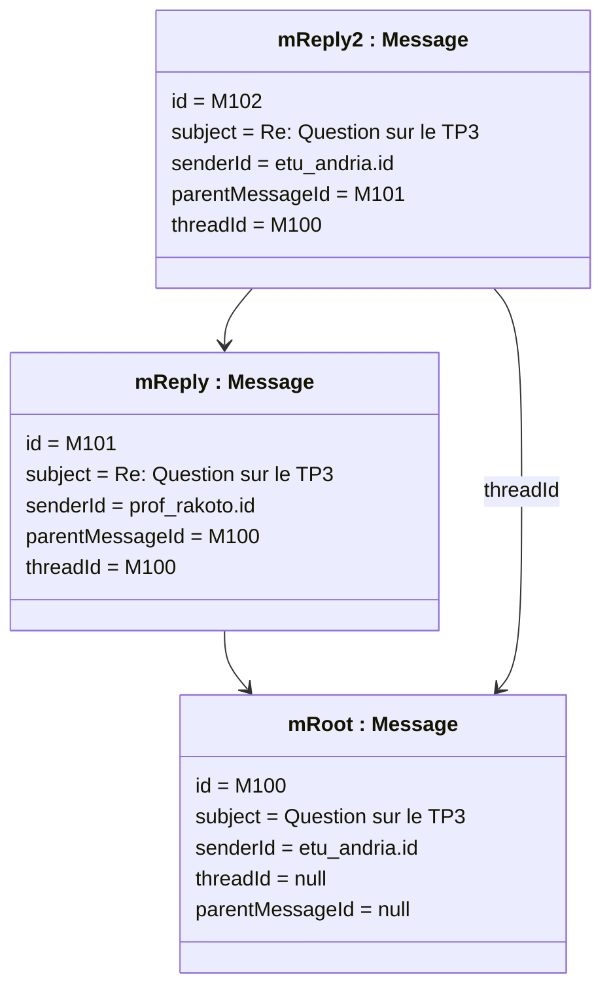

# 04 — Diagramme d'objets

## 1. Introduction

Les diagrammes de classes décrivent la structure générale ; les diagrammes d'objets illustrent une **photo** du système à un instant donné, avec des instances concrètes.

Ce document présente trois scénarios :

1. **Instantané Direction** — un administrateur a inséré les comptes de démonstration (seed initial).
2. **Scénario pédagogique** — un enseignant envoie un message à un groupe de M1 GLBD.
3. **Scénario corbeille partielle** — un message est supprimé par un destinataire mais conservé par les autres.

Les diagrammes sont en Mermaid (notation `classDiagram` adaptée pour représenter des objets avec le préfixe `objet:`).

---

## 2. Représentation graphique principale (PlantUML)



**Figure 4.1 — Diagramme d'objets : scénario d'envoi à un groupe.**

> Source éditable : [`sources/object-diagram.puml`](sources/object-diagram.puml) · Version vectorielle : [SVG](diagrams/svg/object-diagram.svg).

Les sections suivantes détaillent plusieurs scénarios additionnels en Mermaid.

## 3. Scénario 1 — Seed initial

Au premier démarrage, `DataInitializer` crée 7 utilisateurs. Instantané juste après le seed :

```mermaid
classDiagram
    class admin_eni["admin : User"] {
        id = 6aedce82bc3d346c13b4cca1
        email = admin@eni.mg
        role = ROLE_ADMIN
        status = ACTIVE
        filiere = Administration
    }
    class prof_rakoto["prof_rakoto : User"] {
        email = prof.rakoto@eni.mg
        role = ROLE_ENSEIGNANT
        filiere = Informatique
        status = ACTIVE
    }
    class prof_rasolo["prof_rasolo : User"] {
        email = prof.rasolo@eni.mg
        role = ROLE_ENSEIGNANT
        filiere = Mathematiques
    }
    class etu_andria["etu_andria : User"] {
        email = etu.andria@eni.mg
        role = ROLE_ETUDIANT
        filiere = GLBD
        promotion = M1
    }
    class etu_ravelo["etu_ravelo : User"] {
        email = etu.ravelo@eni.mg
        role = ROLE_ETUDIANT
        filiere = GLBD
        promotion = M1
    }
    class etu_ramos["etu_ramos : User"] {
        email = etu.ramos@eni.mg
        role = ROLE_ETUDIANT
        filiere = GLBD
        promotion = M2
    }
    class etu_rajao["etu_rajao : User"] {
        email = etu.rajao@eni.mg
        role = ROLE_ETUDIANT
        filiere = Info
        promotion = L1
    }
```



À ce stade, aucune collection `messages`, `groups`, `attachments` n'est peuplée.

---

## 3. Scénario 2 — Envoi à un groupe M1 GLBD

Étapes :

1. L'admin crée un groupe `M1 GLBD` et y ajoute `etu_andria` et `etu_ravelo`.
2. L'enseignant `prof_rakoto` envoie un message « Planning examens » à ce groupe.
3. Résultat : un `Message` avec 2 `MessageRecipient` (les deux étudiants M1), un `groupIds` traçant l'origine, et deux `Attachment` (ex. un PDF de planning).



**Observations :**

- **Dédoublonnage** : même si le groupe ou une saisie incluaient `etu_andria` deux fois, le `LinkedHashSet` de `buildMessage` garantit `r1 ≠ r2` sur `userId`.
- **Traçabilité** : `m1.groupIds = [gM1.id]` conserve le groupe source même si ses membres changent ultérieurement.
- **État indépendant** : `r1.read` et `r2.read` sont initialisés séparément.

---

## 4. Scénario 3 — Corbeille partielle

**Suite du scénario 2.** `etu_andria` lit et supprime le message ; `etu_ravelo` ne l'a pas encore ouvert. Instantané :



**Illustration des règles métier :**

- **RM-03** : état lu/supprimé **indépendant par destinataire**.
- **RM-04** : `senderDeleted=false` → `prof_rakoto` voit toujours le message dans ses envoyés.
- Si `etu_andria` supprime **définitivement** (UC-21), `r1.deleted` reste `true` mais le document n'est **pas** effacé, car `r2.deleted=false` et `m1.senderDeleted=false` : au moins un acteur voit encore le message.

---

## 5. Scénario 4 — Session authentifiée (Spring Security)

Instantané lorsque `etu_andria` est connectée :

```mermaid
classDiagram
    class etu_andria_user["etu_andria : User"] {
        id = 6aedce82bc3d346c13b4cca4
        email = etu.andria@eni.mg
        status = ACTIVE
        role = ROLE_ETUDIANT
    }
    class cu["currentUser : CurrentUser"] {
        getAuthorities = [ROLE_ETUDIANT]
        isEnabled = true
    }
    class rt["rt42 : RefreshToken"] {
        userId = etu_andria.id
        tokenHash = sha256(...)
        expiresAt = 2026-11-19T08:15:00Z
        revoked = false
    }
    class accessClaims["accessClaims : Claims"] {
        iss = eni-mail
        sub = etu_andria.id
        email = etu.andria@eni.mg
        role = ROLE_ETUDIANT
        typ = ACCESS
        exp = +15min
    }
    cu ..> etu_andria_user : enveloppe
    etu_andria_user --> rt : possède
    cu ..> accessClaims : porté par Authorization: Bearer
```

---

## 6. Scénario 5 — Thread de conversation

Trois messages dans la même conversation (`threadId=m_root.id`) :



**Note** : `threadId` pointe systématiquement vers le **message racine** (pas vers le parent direct), ce qui permet de regrouper toute la conversation avec une seule requête indexée `{threadId, createdAt asc}`.

---

## 7. Suite

→ [05-diagrammes-sequence.md](05-diagrammes-sequence.md) — comment ces objets sont créés et manipulés dans le temps.
