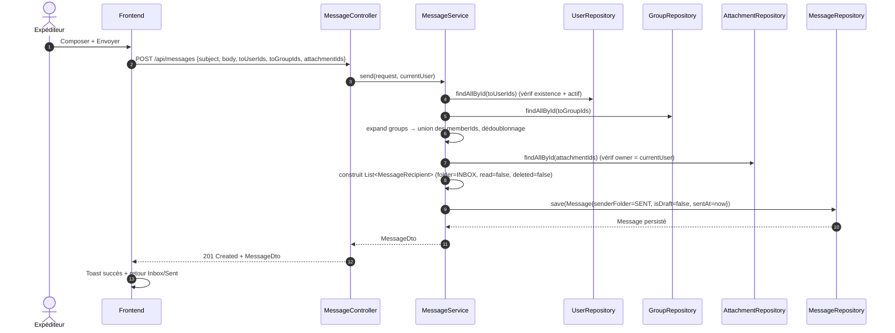
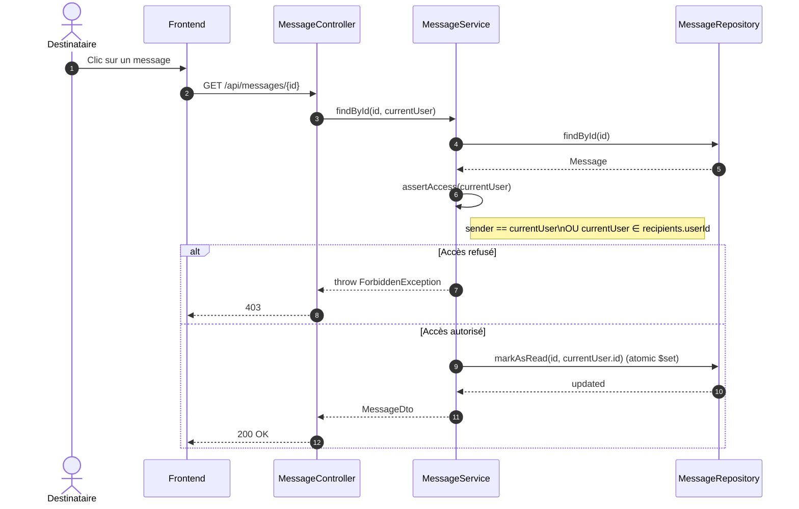
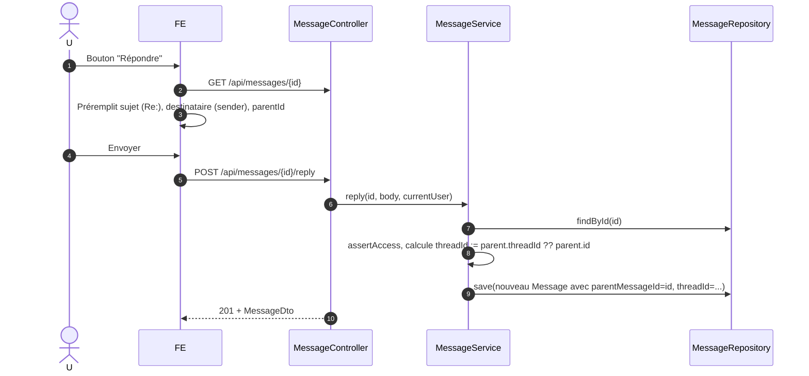
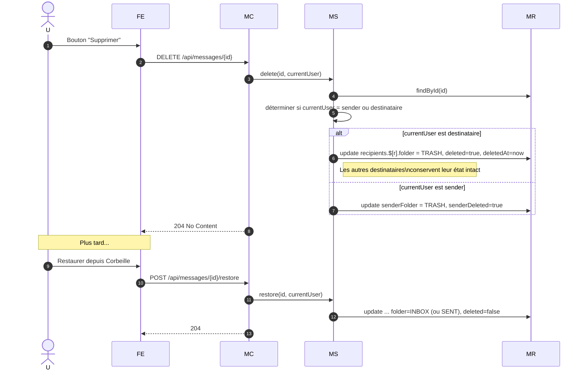
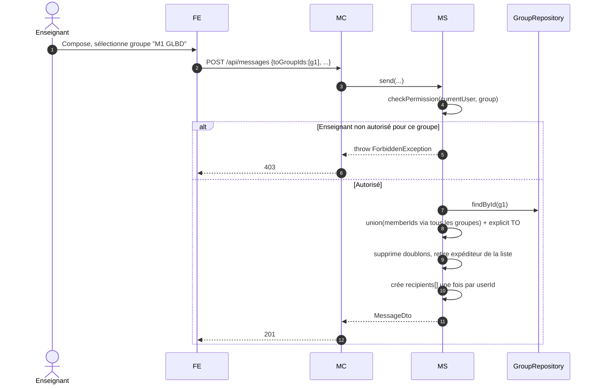

# Séquences — Messagerie

## 1. Envoi d'un message

## 2. Lecture d'un message (destinataire)

## 3. Réponse à un message

## 4. Suppression et restauration (par destinataire uniquement)

## 5. Envoi à un groupe

