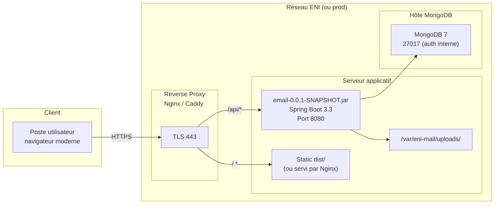

# Architecture technique + Déploiement — ENI Mail

## Architecture logique

```mermaid
flowchart TB
    subgraph Browser["Navigateur"]
        R["React 19 + Vite\nRouter, React Query,\nRHF + Zod, Tailwind v4"]
    end

    subgraph Front["Frontend (static)"]
        VITE["Build Vite (dist/)\nServi par Nginx ou vite preview"]
    end

    subgraph Back["Backend Spring Boot 3.3"]
        direction TB
        CTR["Controllers REST\n/api/..."]
        SEC["Spring Security\nJwtAuthFilter + CORS"]
        SRV["Services\nAuthService, MessageService,\nGroupService, AdminService"]
        REPO["Repositories\n@Repository MongoDB"]
        FS["Local filesystem\nuploads/"]
    end

    subgraph DB["MongoDB 7"]
        USERS[(users)]
        MSGS[(messages)]
        GRPS[(groups)]
        ATT[(attachments)]
        RT[(refresh_tokens)]
    end

    R -->|HTTPS JSON| CTR
    R -->|Cookie HttpOnly refresh| SEC
    CTR --> SEC --> SRV --> REPO --> DB
    SRV --> FS
    USERS -.index text + email unique.-> SRV
    MSGS -.index recipients.userId, threadId.-> SRV
```

## Diagramme de déploiement



## Flux d'authentification + JWT

- **Access token JWT** : 15 min, HS256, signé avec `JWT_SECRET` (≥ 32 octets), stocké **en mémoire** côté React.
- **Refresh token JWT** : 7 jours, signé, haché puis stocké en base (`refresh_tokens`), posé en **cookie HttpOnly + Secure + SameSite=Lax**.
- **Rotation** : chaque `POST /api/auth/refresh` révoque l'ancien refresh, en émet un nouveau. Un refresh révoqué utilisé → tous les refresh de l'utilisateur sont invalidés (détection de vol).
- **Logout** : révoque le refresh courant et vide le cookie.

## Convention de pagination

Toutes les listes paginées utilisent le format Spring :

```
GET /api/messages?folder=INBOX&page=0&size=20&sort=sentAt,desc
```

Réponse :

```json
{
  "content": [...],
  "page": 0,
  "size": 20,
  "totalElements": 134,
  "totalPages": 7,
  "first": true,
  "last": false
}
```

## Codes d'erreur

| HTTP | Signification | Cas typiques |
|---|---|---|
| 400 | Validation des données | Champ manquant, format invalide |
| 401 | Non authentifié | Token absent, expiré, invalide |
| 403 | Autorisé mais droits insuffisants | Étudiant tente une action admin, accès message d'autrui |
| 404 | Ressource inexistante | Message/groupe/utilisateur non trouvé |
| 409 | Conflit | Email déjà pris, nom de groupe en double |
| 413 | Fichier trop volumineux | Upload > 5 Mo |
| 415 | Type MIME non supporté | Extension/type bloqué |
| 429 | Trop de requêtes | Rate-limit login (brute-force) |
| 500 | Erreur serveur | Non prévu, journalisé |

Format uniforme (voir `GlobalExceptionHandler`) :

```json
{
  "timestamp": "2026-11-06T13:45:00Z",
  "status": 403,
  "error": "Forbidden",
  "code": "MESSAGE_ACCESS_DENIED",
  "message": "Vous n'êtes pas destinataire de ce message",
  "path": "/api/messages/652..."
}
```
