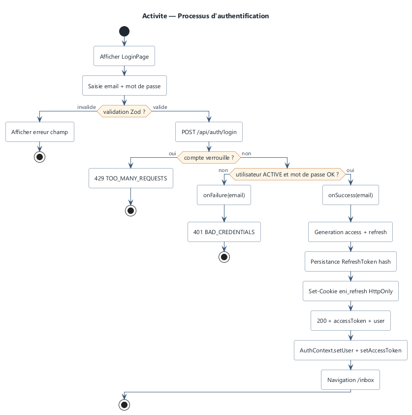
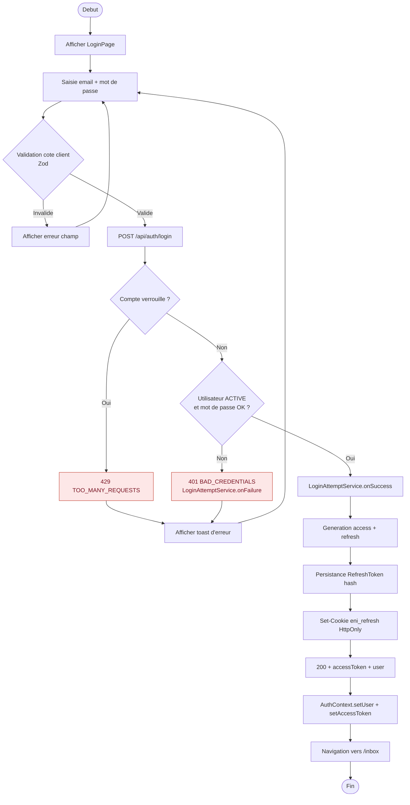
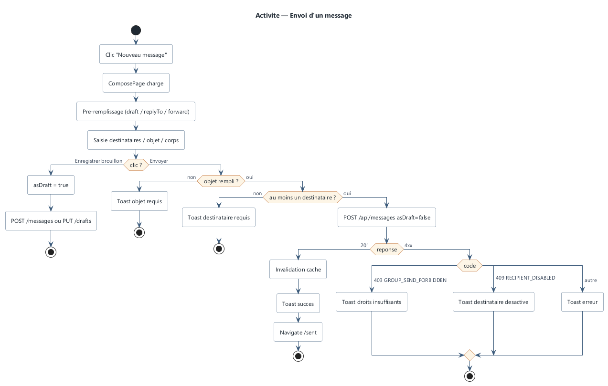
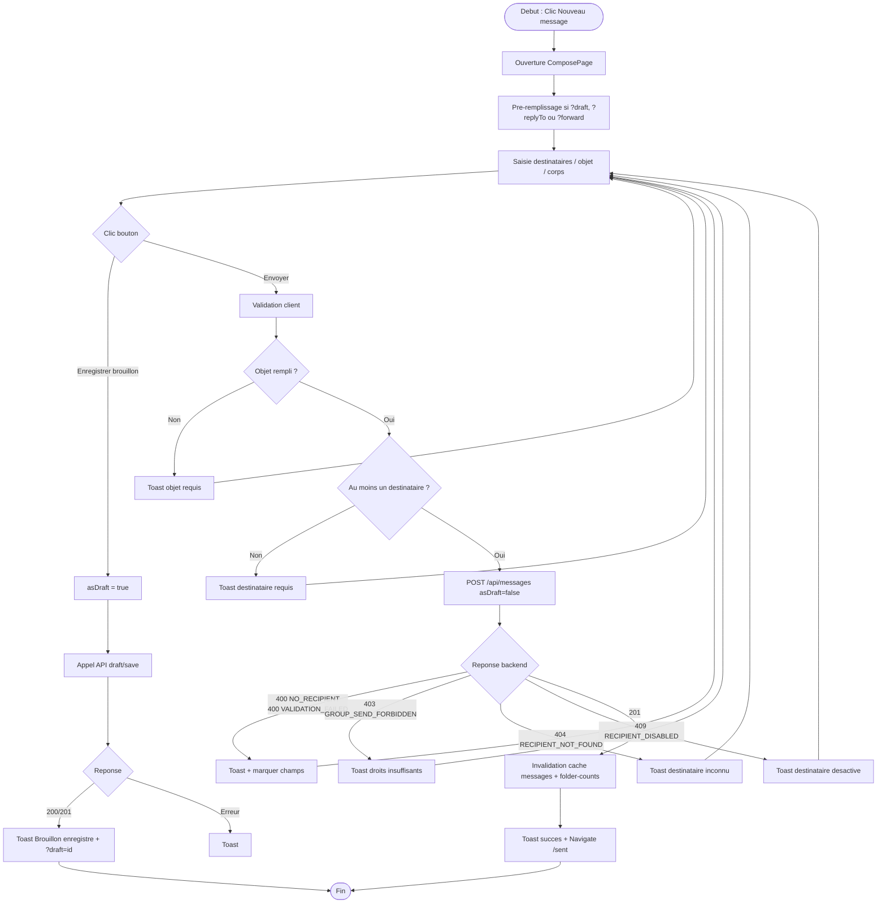
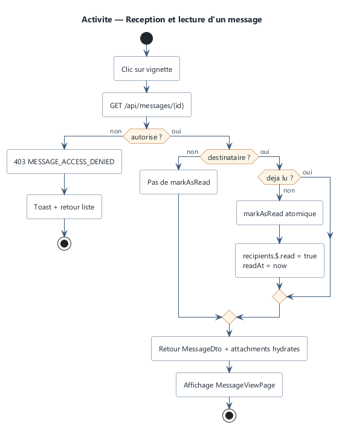
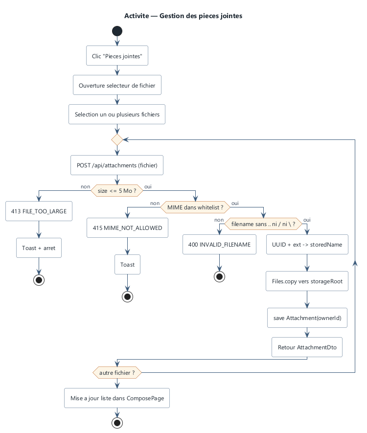
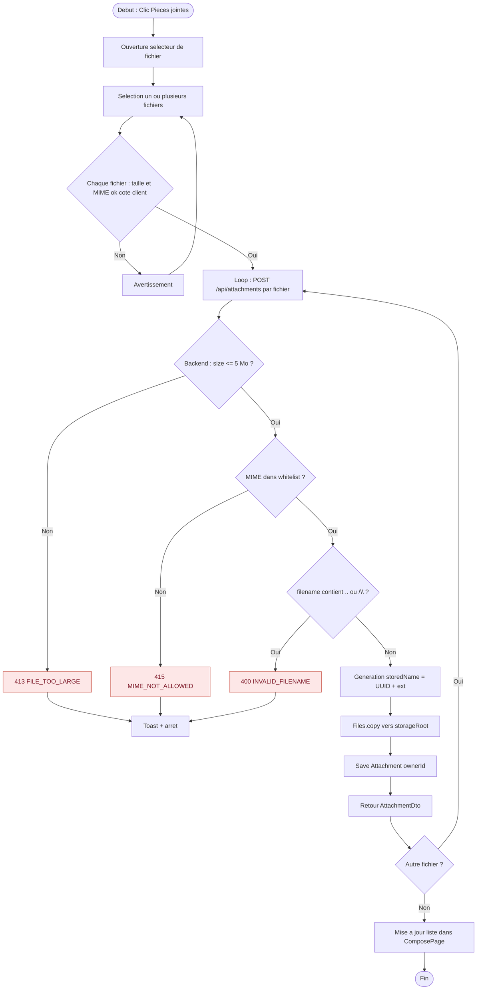
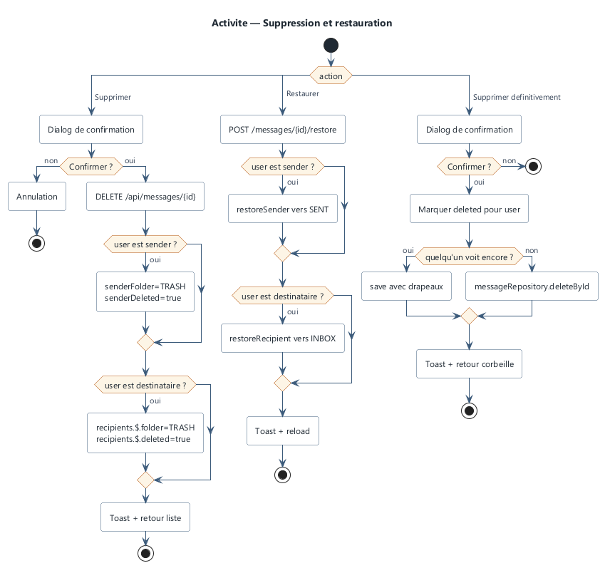
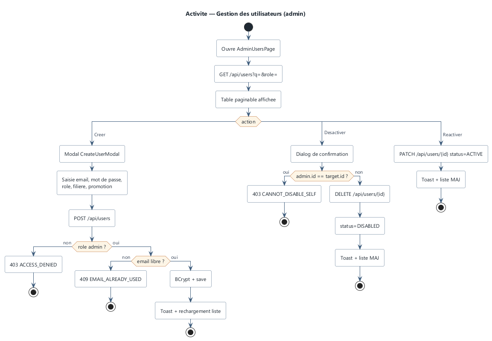

# 06 — Diagrammes d'activité

## 1. Introduction

Les diagrammes de séquence ([fichier 05](05-diagrammes-sequence.md)) décrivent les interactions entre composants. Les diagrammes d'activité présentent les **workflows** d'un point de vue processus : actions, décisions, parallélismes, points finaux.

Notation Mermaid `flowchart`. Chaque activité commence par `Debut` (cercle plein) et termine par `Fin` (cercle avec anneau).

---

## 2. AC-01 — Processus d'authentification



**Figure 6.1 — Processus d'authentification.** · Source : [`sources/activity/authentication.puml`](sources/activity/authentication.puml) · [SVG](diagrams/svg/activity/authentication-activity.svg)



---

## 3. AC-02 — Processus d'envoi d'un message



**Figure 6.2 — Envoi d'un message.** · Source : [`sources/activity/send-message.puml`](sources/activity/send-message.puml) · [SVG](diagrams/svg/activity/send-message-activity.svg)



---

## 4. AC-03 — Processus de réception et lecture



**Figure 6.3 — Réception et lecture.** · Source : [`sources/activity/receive-message.puml`](sources/activity/receive-message.puml) · [SVG](diagrams/svg/activity/receive-message-activity.svg)

```mermaid
flowchart TD
    A([Debut : Clic sur un message en liste]) --> B[GET /api/messages/{id}]
    B --> C{Utilisateur autorise ?}
    C -->|Non| D[403 MESSAGE_ACCESS_DENIED]:::err --> E[Toast + retour liste]
    C -->|Oui| F{Utilisateur est destinataire ?}
    F -->|Non<br/>sender ou admin| G[Pas de markAsRead]
    F -->|Oui| H{Deja lu ?}
    H -->|Oui| G
    H -->|Non| I[markAsRead atomic MongoDB]
    I --> J[recipients.$.read=true, readAt=now]
    G --> K[Retour MessageDto + attachments hydrates]
    J --> K
    K --> L[Affichage MessageViewPage]
    L --> M([Fin])

    classDef err fill:#fde7e7,stroke:#c0392b,color:#7a1121
```

---

## 5. AC-04 — Processus de réponse

```mermaid
flowchart TD
    A([Debut : Clic Repondre]) --> B[Navigation /compose?replyTo={id}&all=0 ou 1]
    B --> C[ComposePage charge le message parent]
    C --> D[Prefix Objet : Re: ...]
    D --> E[Prefill destinataire = sender]
    E --> F{replyAll ?}
    F -->|Non| G[toUsers = parent.sender]
    F -->|Oui| H[toUsers = parent.sender + parent.recipients hors BCC]
    G --> I[Saisie corps]
    H --> I
    I --> J[Envoyer]
    J --> K[POST /api/messages/{id}/reply]
    K --> L[Backend : parentMessageId=parent.id<br/>threadId = parent.threadId OR parent.id]
    L --> M[Save Message + MessageRecipients]
    M --> N([Fin])
```

---

## 6. AC-05 — Processus de transfert

```mermaid
flowchart TD
    A([Debut : Clic Transferer]) --> B[Navigation /compose?forward={id}]
    B --> C[Prefix objet Tr:]
    C --> D[Corps : -- Message transfere -- + body du parent]
    D --> E[Saisie nouveaux destinataires]
    E --> F[Envoyer]
    F --> G[POST /api/messages/{id}/forward]
    G --> H[Backend : construit Message<br/>parentMessageId=parent.id<br/>threadId = parent.threadId OR parent.id]
    H --> I[Pas de copie des PJ du parent]
    I --> J[Save + envoi]
    J --> K([Fin])
```

---

## 7. AC-06 — Processus d'envoi à un groupe

```mermaid
flowchart TD
    A([Debut]) --> B[Compose : selectionne groupe dans RecipientPicker]
    B --> C[toGroupIds += group.id]
    C --> D[Envoyer]
    D --> E[POST /api/messages toGroupIds]
    E --> F[MessageService.send]
    F --> G[GroupRepository.findByIdIn]
    G --> H{Role sender}
    H -->|Admin ou Enseignant| I[Autorise]
    H -->|Etudiant| J{Est membre de chaque groupe ?}
    J -->|Non| K[403 GROUP_SEND_FORBIDDEN]:::err --> L[Toast]
    J -->|Oui| I
    I --> M[Union memberIds de tous les groupes]
    M --> N[Deduplication avec toUserIds + retrait de l'expediteur]
    N --> O[Validation : tous existent et sont ACTIVE]
    O --> P{Tous valides ?}
    P -->|Non| Q[404 RECIPIENT_NOT_FOUND ou 409 RECIPIENT_DISABLED]:::err --> L
    P -->|Oui| R[Construction recipients[]]
    R --> S[Save Message avec groupIds]
    S --> T([Fin])

    classDef err fill:#fde7e7,stroke:#c0392b,color:#7a1121
```

---

## 8. AC-07 — Processus de gestion des pièces jointes



**Figure 6.7 — Gestion des pièces jointes.** · Source : [`sources/activity/attachment-flow.puml`](sources/activity/attachment-flow.puml) · [SVG](diagrams/svg/activity/attachment-flow.svg)



### Suppression d'une PJ (brouillon)

```mermaid
flowchart TD
    A([Debut : Clic X sur PJ]) --> B[DELETE /api/attachments/{id}]
    B --> C{Owner ou admin ?}
    C -->|Non| D[403 ATTACHMENT_FORBIDDEN]:::err
    C -->|Oui| E{Rattachee a un message envoye ?}
    E -->|Oui| F[409 ATTACHMENT_LOCKED]:::err
    E -->|Non| G[Suppression disque + base]
    G --> H[Retrait de la liste UI]
    H --> I([Fin])

    classDef err fill:#fde7e7,stroke:#c0392b,color:#7a1121
```

---

## 9. AC-08 — Processus de suppression et restauration



**Figure 6.8 — Suppression et restauration.** · Source : [`sources/activity/delete-restore.puml`](sources/activity/delete-restore.puml) · [SVG](diagrams/svg/activity/delete-restore.svg)

```mermaid
flowchart TD
    A([Debut]) --> B{Clic sur bouton}
    B -->|Supprimer| C[DELETE /api/messages/{id}]
    B -->|Restaurer| D[POST /api/messages/{id}/restore]
    B -->|Supprimer definitivement| E[DELETE /api/messages/{id}/permanent]
    C --> F[Backend : identifier le role de user]
    F --> G[Si sender : senderFolder=TRASH, senderDeleted=true]
    F --> H[Si destinataire : recipients.$.folder=TRASH, deleted=true]
    G --> I[Save]
    H --> I
    I --> J[Toast + retour liste]
    D --> K[Si sender : restoreSender vers SENT]
    D --> L[Si destinataire : restoreRecipient vers INBOX]
    K --> M[Save]
    L --> M
    M --> N[Toast + reload message]
    E --> O[Marquer deleted pour user]
    O --> P{Quelqu'un voit encore le message ?}
    P -->|Oui| Q[Save avec drapeaux a jour]
    P -->|Non| R[messageRepository.deleteById]
    Q --> S[Toast + retour corbeille]
    R --> S
    S --> T([Fin])
    J --> T
    N --> T
```

---

## 10. AC-09 — Processus de gestion des utilisateurs



**Figure 6.9 — Gestion des utilisateurs.** · Source : [`sources/activity/user-management.puml`](sources/activity/user-management.puml) · [SVG](diagrams/svg/activity/user-management.svg)

```mermaid
flowchart TD
    A([Debut : AdminUsersPage]) --> B[GET /api/users?q=&role=]
    B --> C[Table paginable]
    C --> D{Action}
    D -->|Creer| E[Modal CreateUserModal]
    D -->|Desactiver| F[ConfirmDialog]
    D -->|Reactiver| G[updateUser status=ACTIVE]
    E --> H[Saisie : email, mot de passe, role, filiere, promotion]
    H --> I[POST /api/users]
    I --> J{Backend : ROLE_ADMIN ?}
    J -->|Non| K[403 ACCESS_DENIED]:::err
    J -->|Oui| L{email libre ?}
    L -->|Non| M[409 EMAIL_ALREADY_USED]:::err
    L -->|Oui| N[BCrypt + save]
    N --> O[Toast + rechargement liste]
    F --> P{admin.id == target.id ?}
    P -->|Oui| Q[403 CANNOT_DISABLE_SELF]:::err
    P -->|Non| R[DELETE /api/users/{id}]
    R --> S[status=DISABLED, save]
    S --> O
    G --> O
    O --> T([Fin])

    classDef err fill:#fde7e7,stroke:#c0392b,color:#7a1121
```

---

## 11. AC-10 — Processus de gestion des groupes

```mermaid
flowchart TD
    A([Debut : GroupsPage]) --> B[GET /api/groups]
    B --> C{Role}
    C -->|Etudiant| D[Affiche seulement les groupes ou il est membre]
    C -->|Enseignant/Admin| E[Affiche tous]
    D --> F[Vue lecture seule]
    E --> G{Action}
    G -->|Nouveau groupe| H[POST /api/groups]
    G -->|Supprimer groupe| I[DELETE /api/groups/{id}]
    G -->|Gerer membres| J[Modal GroupMembersModal]
    H --> K{Enseignant/Admin ?}
    K -->|Non| L[403]:::err
    K -->|Oui| M{Nom libre ?}
    M -->|Non| N[409 GROUP_NAME_TAKEN]:::err
    M -->|Oui| O[Save avec createdBy]
    I --> P{Admin OU createur ?}
    P -->|Non| Q[403 GROUP_MANAGE_FORBIDDEN]:::err
    P -->|Oui| R[Delete]
    J --> S[Ajouter : POST /api/groups/{id}/members]
    J --> T[Retirer : DELETE /api/groups/{id}/members/{uid}]
    S --> U[Save group.memberIds dedupe]
    T --> V[Save group.memberIds - uid]
    U --> W([Fin])
    V --> W
    O --> W
    R --> W
    F --> W

    classDef err fill:#fde7e7,stroke:#c0392b,color:#7a1121
```

---

## 12. Suite

→ [07-diagrammes-etats-transitions.md](07-diagrammes-etats-transitions.md) — l'évolution de l'état des entités au cours du temps.
