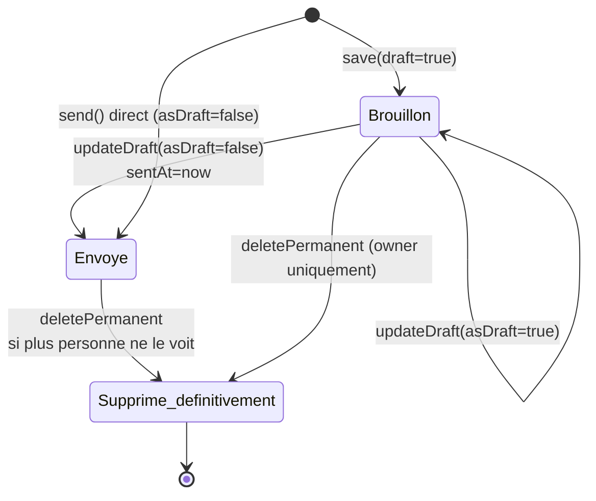
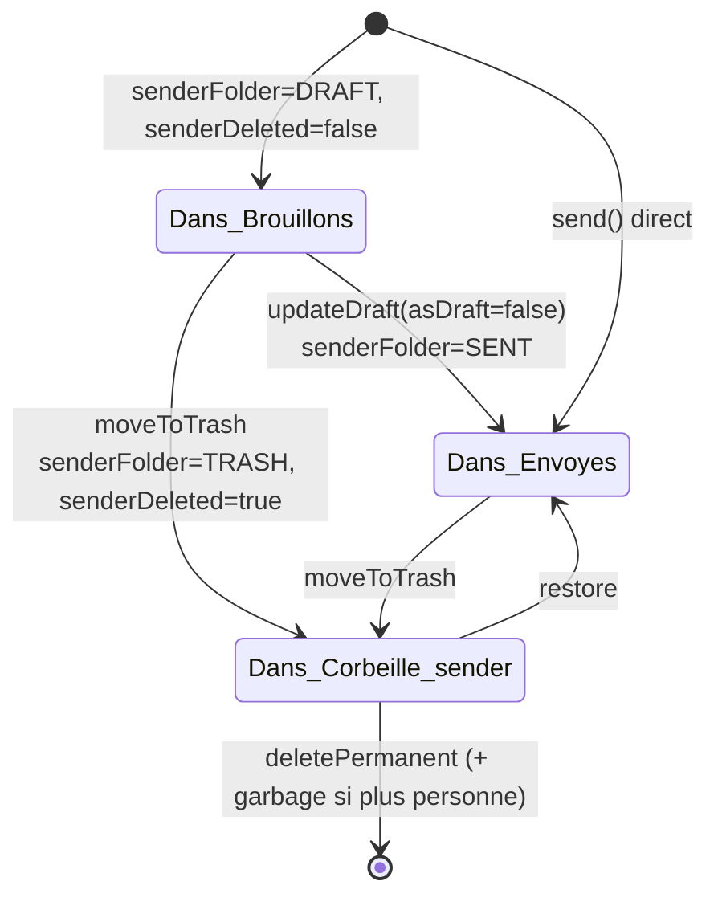
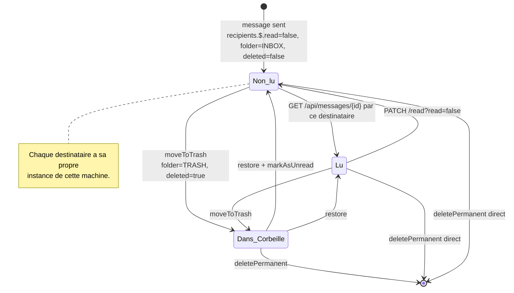
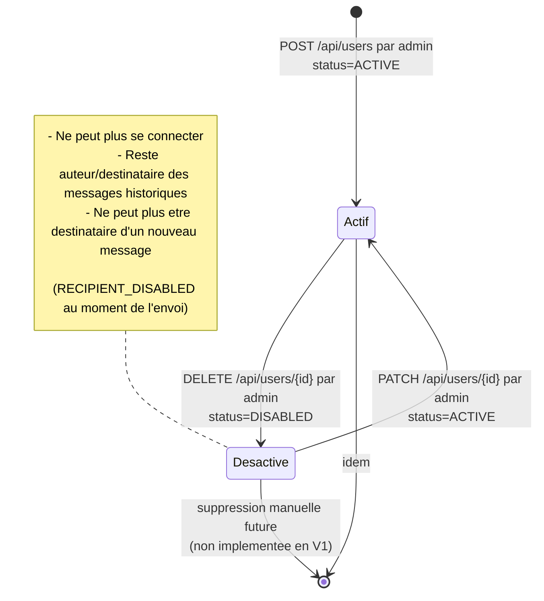
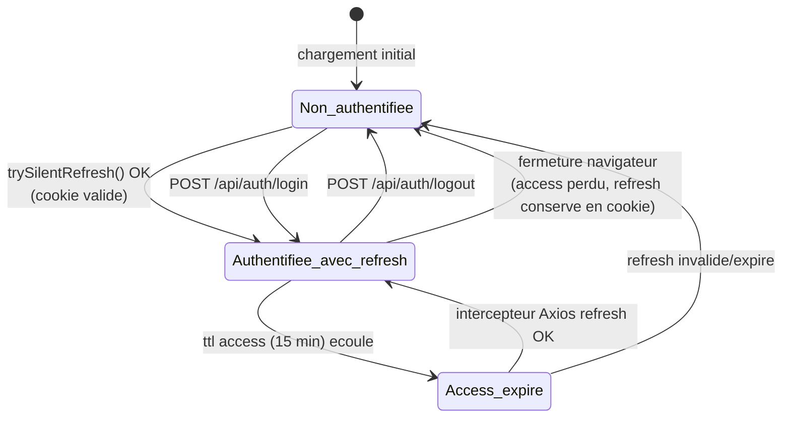
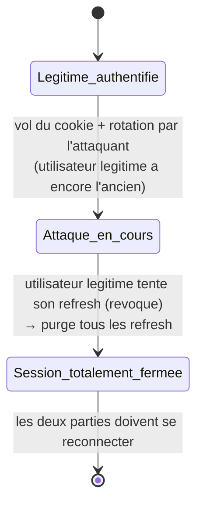
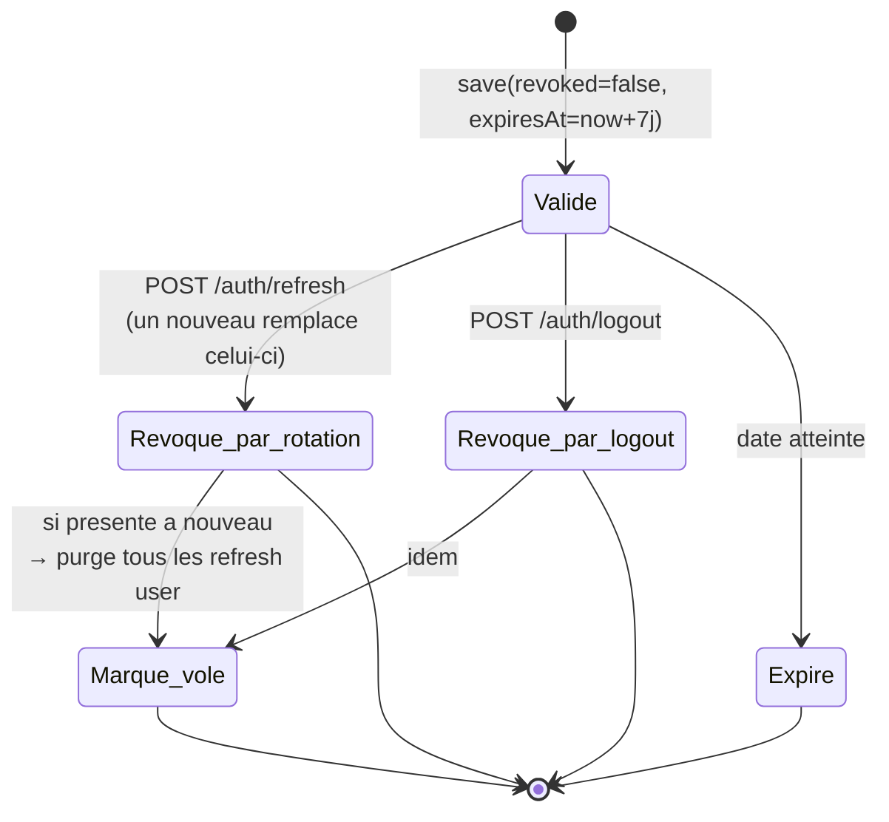
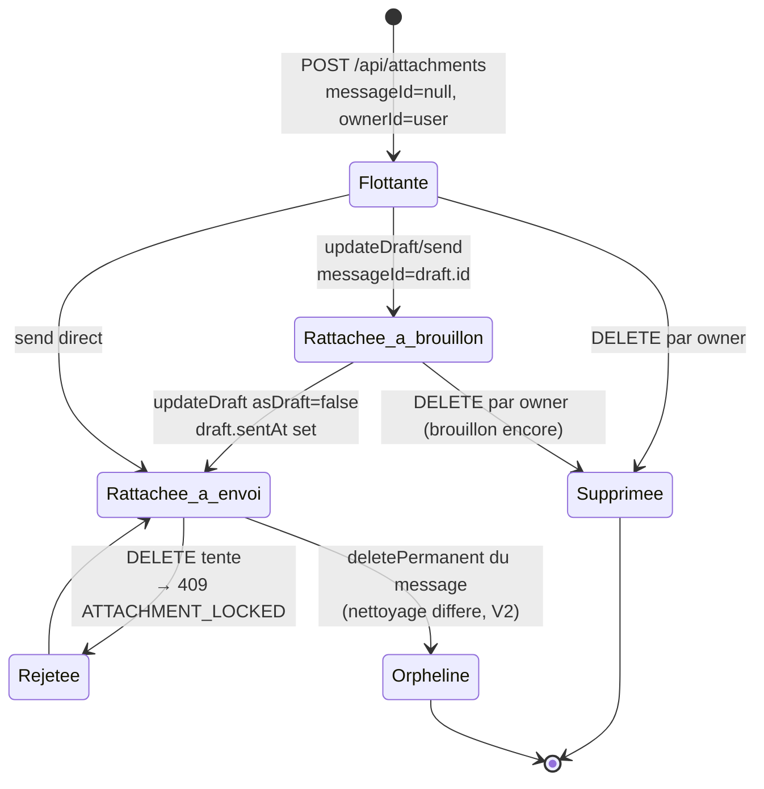
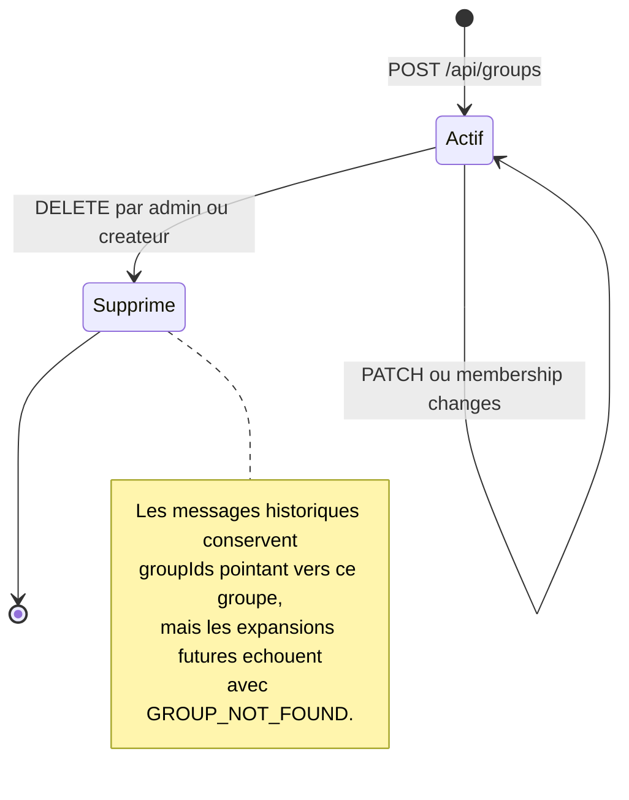

# 07 — Diagrammes d'états-transitions

## 1. Introduction

Ce document présente les **machines à états** des principales entités de ENI Mail. Il souligne le fait que certaines entités ont un état **composite** : le statut d'un `Message` n'est pas unique — il existe une **projection** par acteur (expéditeur et chaque destinataire).

Notation : Mermaid `stateDiagram-v2`.

---

## 2. ET-01 — Cycle de vie d'un message (vue globale)

### 2.1. Problématique

Un message n'a **pas** d'état global unique. Chaque partie prenante a sa propre vue :

- L'expéditeur a `senderFolder ∈ {SENT, DRAFT, TRASH}` et `senderDeleted ∈ {false, true}`.
- Chaque destinataire a `recipients[i].folder ∈ {INBOX, TRASH, DRAFT}`, `read`, `deleted`.

On distingue donc trois machines séparées : **document**, **projection expéditeur**, **projection destinataire**.

### 2.2. ET-01-a — Cycle du document `Message`

**Transitions interdites** : on ne revient pas de `Envoye` vers `Brouillon` (l'envoi est définitif ; pour corriger il faut créer un nouveau message).

### 2.3. ET-01-b — Cycle de la projection « expéditeur »

Décrit par `(senderFolder, senderDeleted)`.

### 2.4. ET-01-c — Cycle de la projection « destinataire » (pour chaque destinataire indépendamment)

### 2.5. Illustration concrète

**Scénario :** `prof_rakoto` envoie à `etu_andria` et `etu_ravelo`. Instantané des trois machines :

| Entité | Machine 1 (document) | Machine 2 (sender) | Machine 3 (etu_andria) | Machine 3 (etu_ravelo) |
|--------|----------------------|--------------------|-------------------------|-------------------------|
| t₀ (envoi) | Envoye | Dans_Envoyes | Non_lu | Non_lu |
| t₁ (etu_andria ouvre) | Envoye | Dans_Envoyes | Lu | Non_lu |
| t₂ (etu_andria supprime) | Envoye | Dans_Envoyes | Dans_Corbeille | Non_lu |
| t₃ (etu_andria supprime def.) | Envoye (encore vu par 2 personnes) | Dans_Envoyes | [⊥] | Non_lu |

**Conclusion** : le document n'est effacé qu'une fois toutes les projections à `[*]` (`someoneStillSees = false` dans [MessageService](../../eni-mail-back/src/main/java/mg/eni/email/service/MessageService.java)).

---

## 3. ET-02 — Cycle de vie d'un utilisateur

### Précisions

- **Pas de suppression dure** en V1 : la désactivation conserve l'historique.
- L'admin ne peut pas **se désactiver lui-même** (RM-02 → 403 `CANNOT_DISABLE_SELF`).
- Un utilisateur désactivé qui aurait un access token encore valide sera refusé au prochain filtre : `JwtAuthenticationFilter` vérifie `isEnabled()` via `CurrentUser`.

---

## 4. ET-03 — Cycle de vie d'une session

### Points détaillés

| État | Marqueurs | Côté front | Côté back |
|------|-----------|------------|-----------|
| Non authentifiée | Pas de `accessToken` en mémoire, cookie absent/expiré. | `user = null`, route `/login`. | Pas de SecurityContext. |
| Authentifiée avec refresh | `accessToken` en mémoire + cookie `eni_refresh` valide. | `user` défini, navigation libre. | `CurrentUser` dans `SecurityContext` pendant chaque requête. |
| Access expiré | `accessToken` toujours en mémoire mais le serveur retourne 401. | L'intercepteur Axios déclenche automatiquement `/auth/refresh`. | Backend rejette 401 sur les endpoints protégés. |

### Détection de vol

Si un ancien `refresh` révoqué est présenté, `AuthService.refresh` **révoque tous les refresh de l'utilisateur** — scénario :

---

## 5. ET-04 — Cycle de vie d'un `RefreshToken`

---

## 6. ET-05 — Cycle de vie d'une pièce jointe

**Note V1** : les pièces jointes orphelines (après suppression définitive d'un message) ne sont pas garbage-collectées automatiquement — à ajouter en V2 via un job planifié.

---

## 7. ET-06 — Cycle de vie d'un groupe

---

## 8. Récapitulatif des invariants

| Invariant | Garantie |
|-----------|----------|
| Un refresh révoqué ne peut jamais redonner un access. | `AuthService.refresh` vérifie `stored.isRevoked()`. |
| Un message ne peut repasser de `Envoye` à `Brouillon`. | Aucune API ne permet cette transition. |
| La corbeille d'un destinataire n'affecte pas les autres. | Mise à jour atomique `recipients.$.folder`. |
| Un compte désactivé ne peut plus émettre de requêtes authentifiées. | `CurrentUser.isEnabled()` vérifié par `JwtAuthenticationFilter`. |
| Un draft ne peut pas être envoyé sans destinataire. | `MessageService.buildMessage` : `NO_RECIPIENT`. |

---

## 9. Suite

→ [08-diagramme-composants.md](08-diagramme-composants.md) — architecture statique du système.
