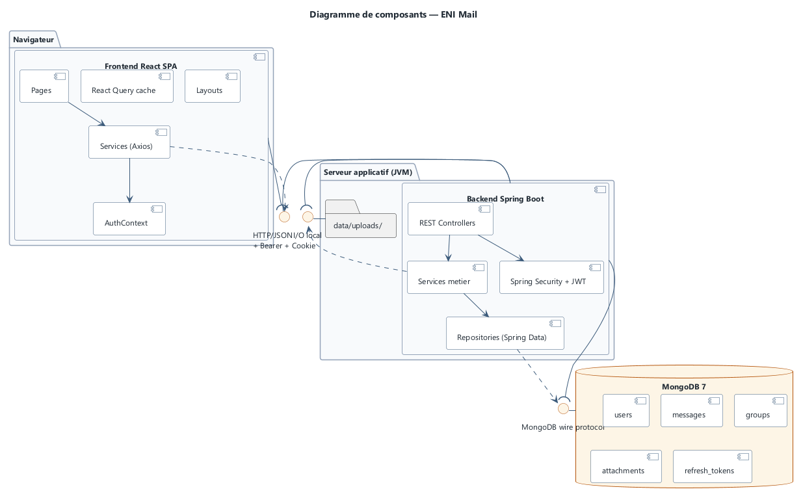
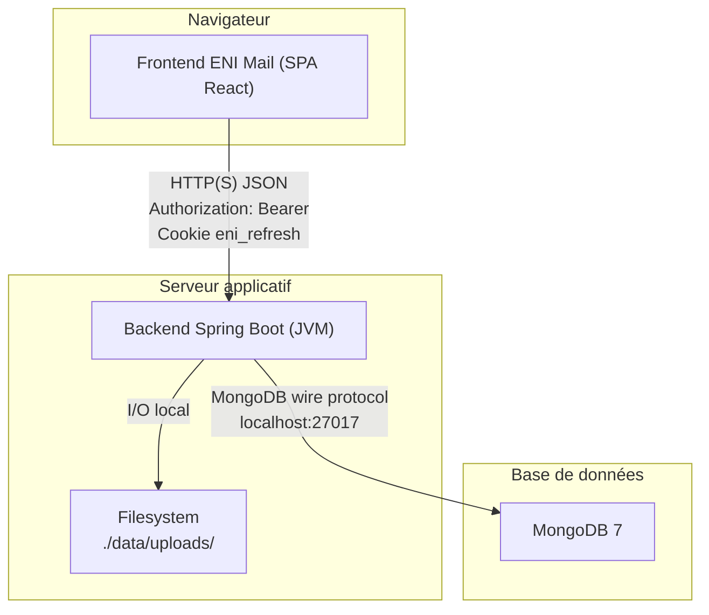
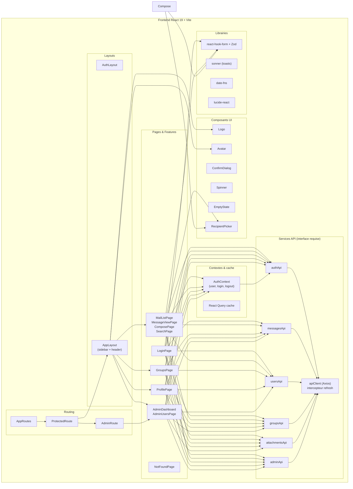
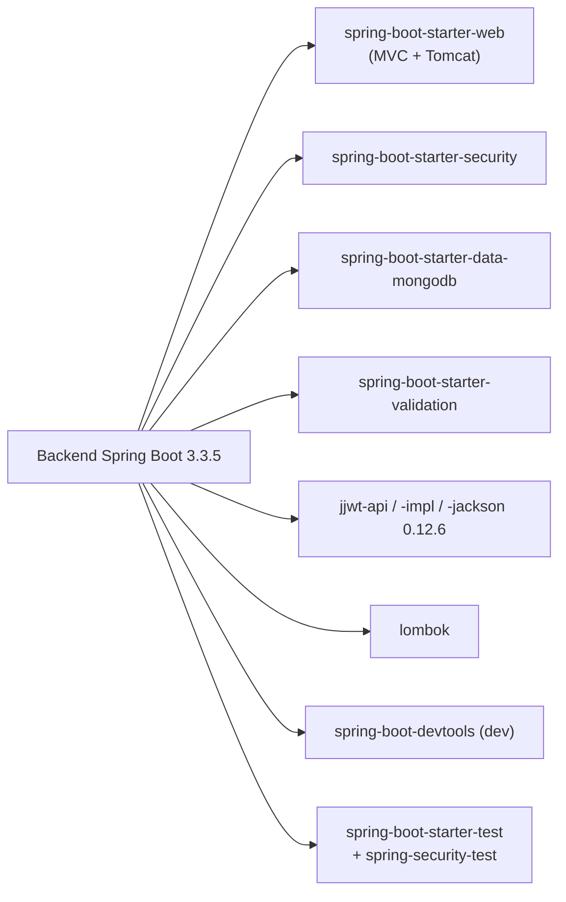
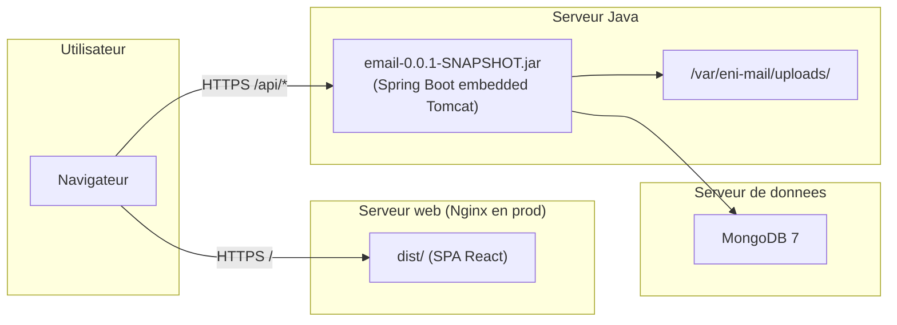

# 08 — Diagramme de composants

## 1. Introduction

Ce document présente les **composants logiciels** d'ENI Mail et leurs interfaces. Il s'agit d'une vue UML 2.5 des *Components*, plus détaillée qu'un simple diagramme d'architecture.

Un composant est une unité de livraison avec des **interfaces requises** (ce dont il a besoin) et des **interfaces fournies** (ce qu'il expose).

---

## 2. Vue générale

### Représentation graphique (PlantUML)

**Figure 8.1 — Composants logiciels et interfaces d'ENI Mail.**

> Source éditable : [`sources/component-diagram.puml`](sources/component-diagram.puml) · Version vectorielle : [SVG](diagrams/svg/component-diagram.svg).

### Équivalent Mermaid

---

## 3. Composants du frontend

### Interfaces fournies par le frontend

- **UI web** : SPA servie sur `/` (dev : `http://localhost:5173`, prod : via Nginx).

### Interfaces requises par le frontend

- **API REST ENI Mail** : préfixe `/api` (proxyé par Vite en dev).
- **Google Fonts** : chargement de Inter + Manrope + JetBrains Mono.

---

## 4. Composants du backend

```mermaid
flowchart LR
    subgraph BE["Backend Spring Boot 3.3"]
        direction TB

        subgraph Controllers["Couche presentation"]
            AC["AuthController"]
            UC["UserController"]
            MC["MessageController"]
            GC["GroupController"]
            AtC["AttachmentController"]
            SC["SearchController"]
            AdC["AdminController"]
        end

        subgraph Security["Spring Security"]
            SF["SecurityFilterChain"]
            Jfilter["JwtAuthenticationFilter"]
            CUDS["CustomUserDetailsService"]
            BCrypt["PasswordEncoder (BCrypt)"]
            JS["JwtService"]
            LA["LoginAttemptService"]
            SU["SecurityUtils"]
            Cfg["SecurityConfig<br/>+ CorsConfig"]
            PropsJwt["JwtProperties"]
            PropsCors["CorsProperties"]
        end

        subgraph Services["Couche metier"]
            AuthS["AuthService"]
            UserS["UserService"]
            MsgS["MessageService"]
            GrpS["GroupService"]
            AttS["AttachmentService"]
            AdmS["AdminStatsService"]
        end

        subgraph Repositories["Couche acces donnees"]
            UR["UserRepository"]
            MR["MessageRepository<br/>+ MessageRepositoryCustom"]
            GR["GroupRepository"]
            AR["AttachmentRepository"]
            RTR["RefreshTokenRepository"]
            MT["MongoTemplate<br/>(mises a jour atomiques)"]
        end

        subgraph Docs["Documents / enums / DTO"]
            DocUser["User, RefreshToken"]
            DocMsg["Message + MessageRecipient<br/>+ MessageFolder, RecipientType"]
            DocGrp["Group"]
            DocAtt["Attachment"]
            Role["Role, AccountStatus"]
            Dtos["DTO : *Request, *Dto<br/>+ ApiErrorResponse"]
        end

        subgraph Config["Configuration"]
            Init["DataInitializer"]
            MCfg["MongoConfig"]
            AttP["AttachmentProperties"]
            AdmP["AdminSeedProperties"]
            SecP["SecurityProperties"]
        end

        subgraph Exceptions["Gestion d'erreurs"]
            GEH["GlobalExceptionHandler"]
            Biz["BusinessException<br/>+ Forbidden, Resource, Conflict,<br/>Unauthorized, TooManyRequests"]
        end
    end

    AC --> AuthS
    UC --> UserS
    MC --> MsgS
    GC --> GrpS
    AtC --> AttS
    SC --> MsgS & MR
    AdC --> AdmS

    AuthS --> UserS & JS & LA & RTR & BCrypt
    UserS --> UR & BCrypt
    MsgS --> MR & UR & GR & AR
    GrpS --> GR & UR
    AttS --> AR & MR & AttP
    AdmS --> UR & MT

    SF --> Jfilter --> JS & CUDS
    Cfg --> SF & BCrypt & CUDS
    CUDS --> UR
    AC & UC & MC & GC & AtC & SC & AdC --> SU
    SU --> SecP

    UR --> DocUser
    MR --> DocMsg
    GR --> DocGrp
    AR --> DocAtt
    RTR --> DocUser

    AC & UC & MC & GC & AtC & SC & AdC --> Dtos

    Init --> UR & BCrypt & AdmP

    GEH --> Biz
    AC & UC & MC & GC & AtC & SC & AdC --> GEH
```

### Interfaces fournies

| Interface | Protocole | Implémentation |
|-----------|-----------|----------------|
| `IAuthAPI` | REST JSON | `/api/auth/*` |
| `IUserAPI` | REST JSON | `/api/users/*` |
| `IMessageAPI` | REST JSON | `/api/messages/*` |
| `IFolderCountsAPI` | REST JSON | `/api/messages/folders/counts` |
| `ISearchAPI` | REST JSON | `/api/search` |
| `IGroupAPI` | REST JSON | `/api/groups/*` |
| `IAttachmentAPI` | REST JSON + multipart | `/api/attachments/*` |
| `IAdminAPI` | REST JSON | `/api/admin/*` |

### Interfaces requises

| Interface | Fournisseur | Fichier |
|-----------|-------------|---------|
| `MongoDB` | Serveur MongoDB 7 | `application-dev.yml` → `spring.data.mongodb.uri` |
| `Filesystem` | OS hôte | `AttachmentProperties.storagePath` (dev : `./data/uploads`) |
| `JVM 17+` | OpenJDK 21 | `pom.xml` java.version |

---

## 5. Dépendances principales (vue Maven simplifiée)

---

## 6. Vue déploiement condensée

Les composants cités sont déployés comme suit :

Détail complet dans [09-diagramme-deploiement.md](09-diagramme-deploiement.md).

---

## 7. Suite

→ [09-diagramme-deploiement.md](09-diagramme-deploiement.md) — nœuds physiques, ports, environnements.
