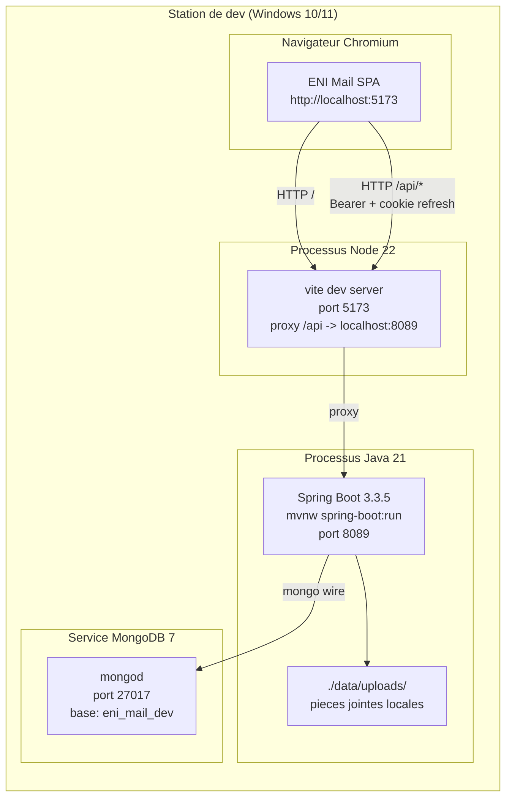
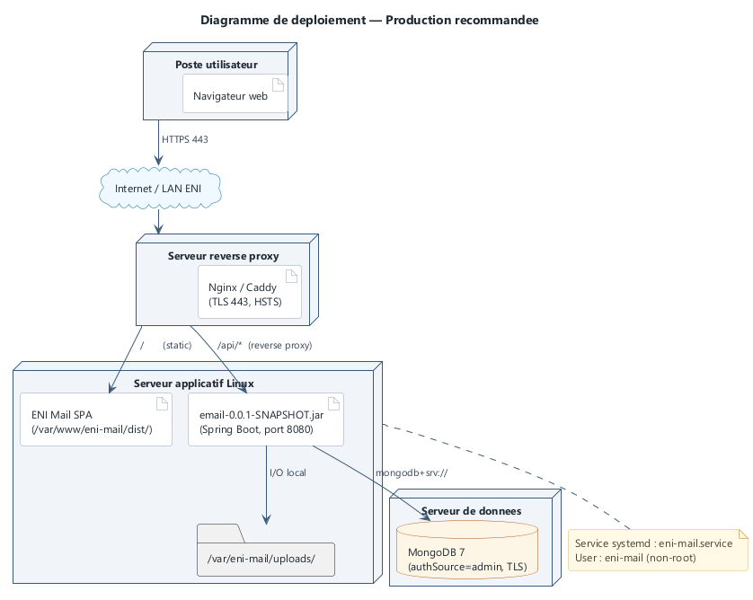
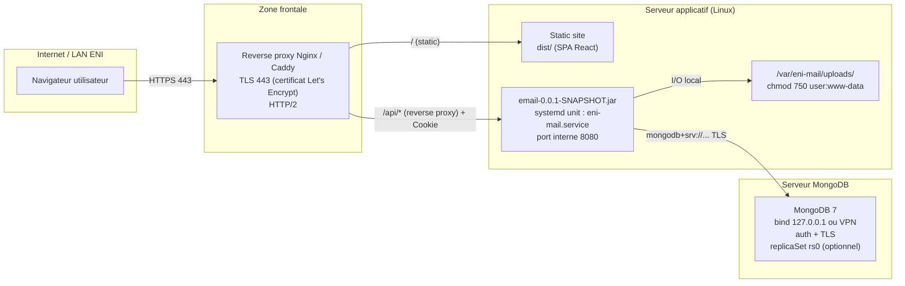
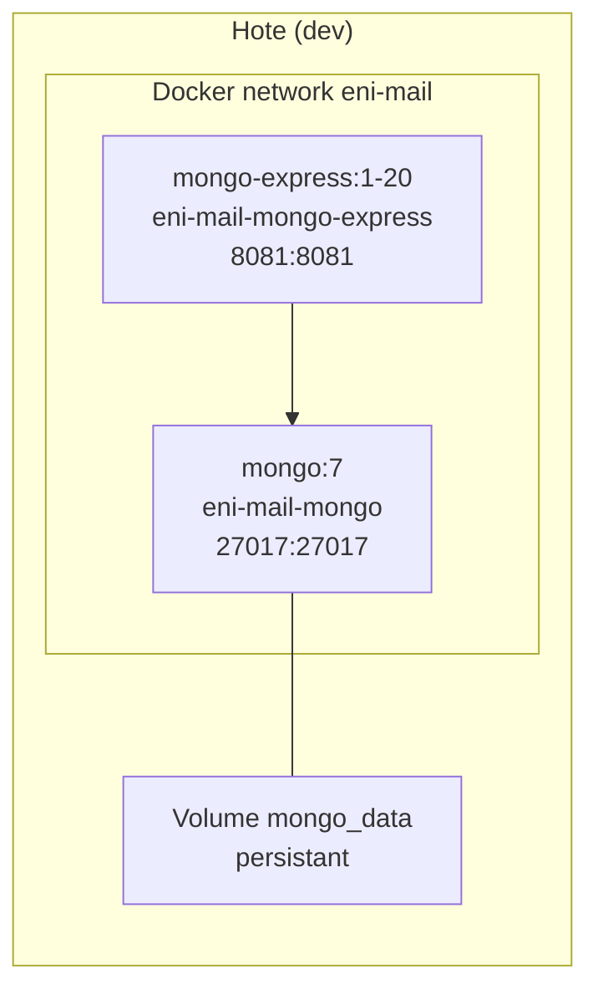

# 09 — Diagramme de déploiement

## 1. Introduction

Ce document décrit le **déploiement physique** d'ENI Mail dans deux environnements :

1. **Développement** (station de travail unique sous Windows, configuration vérifiée sur ce dépôt).
2. **Production** (recommandation ; à valider par le service infrastructure de l'ENI).

Les nœuds représentent les machines ou conteneurs ; les artefacts représentent les livrables déployés.

---

## 2. Environnement de développement



### Caractéristiques

| Élément | Valeur dev | Fichier |
|---------|------------|---------|
| Port frontend | 5173 (fallback 5174, 5175…) | [vite.config.ts](../../eni-mail-frontend/vite.config.ts) |
| Port backend | 8089 (variable `SERVER_PORT`) | [application.yml](../../eni-mail-back/src/main/resources/application.yml) |
| Port MongoDB | 27017 | — |
| Base MongoDB | `eni_mail_dev` | [application-dev.yml](../../eni-mail-back/src/main/resources/application-dev.yml) |
| Stockage PJ | `./data/uploads/` (dossier backend) | `AttachmentProperties.storagePath` |
| CORS autorisé | `http://localhost:5173`, `http://127.0.0.1:5173` | `CorsProperties.allowedOrigins` |
| JWT TTL access | 15 min | `JwtProperties.accessTokenTtlMinutes` |
| JWT TTL refresh | 7 j | `JwtProperties.refreshTokenTtlDays` |

### Pourquoi 8089 et pas 8080 ?

Sur beaucoup de postes, le port 8080 est occupé (Oracle REST, EnterpriseDB PEM, Jenkins, Tomcat local…). Le projet a adopté 8089 par défaut — modifiable via `SERVER_PORT=xxxx` et `VITE_API_TARGET=http://localhost:xxxx`.

---

## 3. Environnement de production (recommandation)

### Représentation graphique (PlantUML)



**Figure 9.1 — Déploiement de production recommandé.**

> Source éditable : [`sources/deployment-diagram.puml`](sources/deployment-diagram.puml) · Version vectorielle : [SVG](diagrams/svg/deployment-diagram.svg).

### Équivalent Mermaid



### Paramétrage recommandé en production

| Paramètre | Valeur recommandée | Raison |
|-----------|--------------------|--------|
| Protocole | **HTTPS uniquement** (HSTS) | Confidentialité du JWT dans les headers + cookie refresh. |
| Cookie `eni_refresh` | `Secure=true` (voir `AuthController`) | Le cookie n'est transmis qu'en HTTPS. |
| `CORS_ALLOWED_ORIGINS` | `https://mail.eni.mg` (exact) | Pas de jokers, pas de `*`. |
| `JWT_SECRET` | Variable d'env, 48+ octets aléatoires | Jamais dans le code. |
| MongoDB auth | `authSource=admin`, utilisateur dédié `eni_mail` | Moindre privilège. |
| MongoDB réseau | `bind_ip=127.0.0.1` (si même serveur) ou VPN privé | Pas d'exposition publique. |
| Backup MongoDB | `mongodump` quotidien + rétention 30 j | PRA. |
| Stockage PJ | Volume dédié `/var/eni-mail/uploads/`, chmod strict | Isolation. |
| Logs | `/var/log/eni-mail/*.log` rotation quotidienne | Observabilité. |
| Monitoring | Prometheus endpoint (à ajouter : `spring-boot-starter-actuator`) | SRE. |
| Resources | 1 vCPU / 2 Go RAM mini pour 500 utilisateurs | Dimensionnement cible V1. |

### Unité systemd suggérée (production)

```ini
# /etc/systemd/system/eni-mail.service
[Unit]
Description=ENI Mail backend
After=network.target mongodb.service

[Service]
Type=simple
User=eni-mail
WorkingDirectory=/opt/eni-mail
EnvironmentFile=/etc/eni-mail/env
ExecStart=/usr/bin/java -jar /opt/eni-mail/email.jar
Restart=on-failure
RestartSec=10

[Install]
WantedBy=multi-user.target
```

### Configuration Nginx condensée (reverse proxy)

```nginx
server {
    listen 443 ssl http2;
    server_name mail.eni.mg;

    ssl_certificate /etc/letsencrypt/live/mail.eni.mg/fullchain.pem;
    ssl_certificate_key /etc/letsencrypt/live/mail.eni.mg/privkey.pem;

    # Static SPA
    root /var/www/eni-mail;
    location / {
        try_files $uri /index.html;
    }

    # API backend
    location /api/ {
        proxy_pass http://127.0.0.1:8080;
        proxy_http_version 1.1;
        proxy_set_header Host $host;
        proxy_set_header X-Forwarded-For $proxy_add_x_forwarded_for;
        proxy_set_header X-Forwarded-Proto https;
        proxy_read_timeout 90s;
    }

    # HSTS
    add_header Strict-Transport-Security "max-age=63072000; includeSubDomains" always;
}
```

---

## 4. Variante avec Docker Compose (développement rapide)

Déjà livrée sous [docker-compose.yml](../../docker-compose.yml) :



Usage : `docker compose up -d` démarre MongoDB sans authentification (cf. commentaire dans le fichier) pour le développement.

---

## 5. Caractéristiques dimensionnelles cibles

| Indicateur | Cible V1 | Justification |
|-----------|----------|---------------|
| Utilisateurs simultanés | 100 | Volumétrie ENI. |
| Messages/jour | 1 000 (campagnes) | Vol. estimée. |
| Taille médiane message | 2 Ko (texte seul) | Observée. |
| Taille max PJ | 5 Mo/fichier | Config applicative. |
| Temps de réponse API | < 2 s p95 | Spec. |
| Disponibilité | > 99 % (1 h de maintenance/mois) | Objectif raisonnable V1. |

---

## 6. Suite

→ [10-diagramme-packages.md](10-diagramme-packages.md) — organisation logique du code source.
