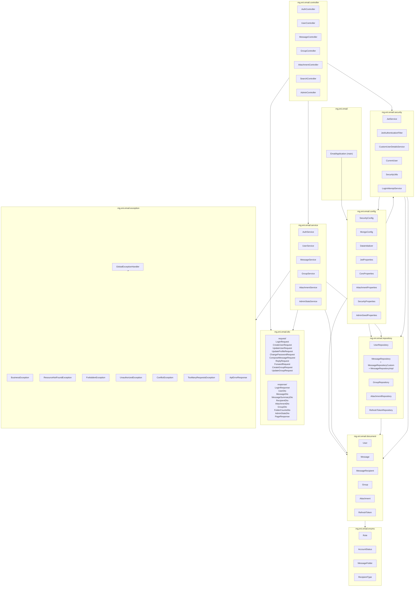
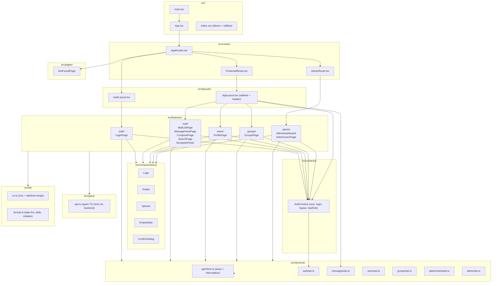
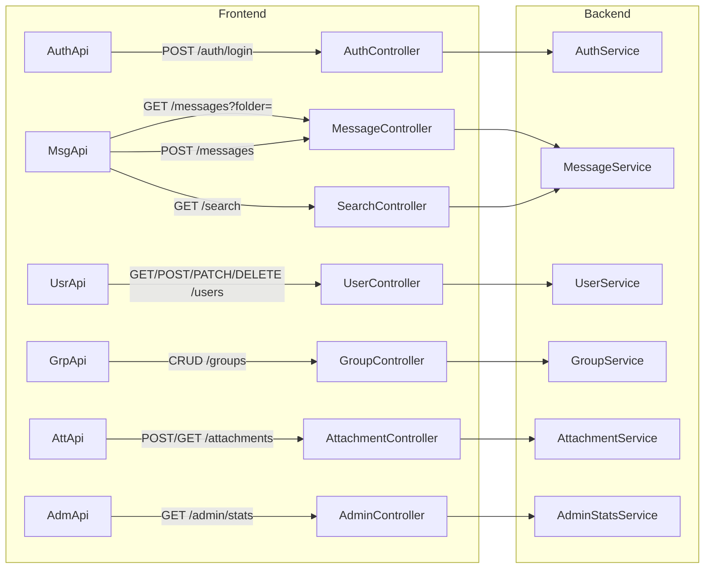

# 10 — Diagramme de packages

## 1. Introduction

Ce document décrit l'organisation logique du code source — **packages Java** côté backend et **dossiers/modules** côté frontend. Il sert de carte au développeur qui reprend le projet.

---

## 2. Backend — packages Java

**Racine** : `mg.eni.email` dans [eni-mail-back/src/main/java/](../../eni-mail-back/src/main/java/mg/eni/email/).

### Règles de dépendance

| Du package | Vers | Autorisé |
|------------|------|:--------:|
| `controller` | `service`, `dto`, `security`, `exception` | ✅ |
| `controller` | `repository` | ❌ (interdit — passe par `service`) |
| `service` | `repository`, `document`, `dto`, `exception`, `enums` | ✅ |
| `repository` | `document`, `enums` | ✅ |
| `repository` | `service` | ❌ |
| `document` | `enums` | ✅ |
| `document` | `service`, `controller` | ❌ |
| `security` | `document`, `repository`, `config`, `exception` | ✅ |
| `dto` | `enums`, `document` (lecture seule pour construction) | ✅ |
| `exception` | — (aucun) | ✅ |

### Responsabilités par package

| Package | Responsabilité | Taille approx. |
|---------|----------------|----------------|
| `config` | Beans Spring, propriétés, seed. | 8 classes |
| `security` | Tout ce qui touche à l'auth et au contrôle d'accès. | 6 classes |
| `controller` | Contrat HTTP, mapping URL. **Pas de logique métier.** | 7 classes |
| `service` | Règles métier, orchestration. | 6 classes |
| `repository` | Accès MongoDB (Spring Data + MongoTemplate). | 5+ classes |
| `document` | Entités persistées. | 6 classes |
| `dto` | DTO requête/réponse (sérialisation). | ~22 records |
| `enums` | Types énumérés. | 4 enums |
| `exception` | Exceptions métier + handler global. | 8 classes |

---

## 3. Frontend — modules React

**Racine** : [eni-mail-frontend/src/](../../eni-mail-frontend/src/).

### Règles de dépendance frontend

| De | Vers | Autorisé |
|----|------|:--------:|
| `features/*` | `components/ui`, `services`, `contexts`, `lib`, `types` | ✅ |
| `features/*` | autres `features/*` (import direct) | ⚠️ à éviter (préférer réutilisation via composants partagés) |
| `services/*` | `types/api` | ✅ |
| `services/*` | `features/*` | ❌ (couche basse) |
| `components/ui` | `lib`, aucune `services` | ✅ |
| `contexts/AuthContext` | `services/authApi`, `services/apiClient` | ✅ |
| `routes/*` | `features/*`, `layouts/*` | ✅ |

### Responsabilités

| Module | Responsabilité |
|--------|----------------|
| `main.tsx` | Bootstrap React. |
| `App.tsx` | Providers (Query, Router, Auth, Toaster). |
| `routes/` | Mapping URL ↔ pages, protection de routes. |
| `layouts/` | Chrome visuel (sidebar, topbar, splash d'auth). |
| `features/` | Pages métier regroupées par domaine. |
| `components/ui/` | Primitives UI réutilisables. |
| `pages/` | Pages hors feature (ex : 404). |
| `contexts/` | État global non serveur (ici : auth). |
| `services/` | Appels HTTP typés. |
| `types/` | Types TypeScript partagés. |
| `lib/` | Helpers purs. |
| `index.css` | Tokens de design + utilities Tailwind v4. |

---

## 4. Vue en pile — mapping API

---

## 5. Suite

→ [11-modele-donnees-mongodb.md](11-modele-donnees-mongodb.md) — structure NoSQL détaillée.
