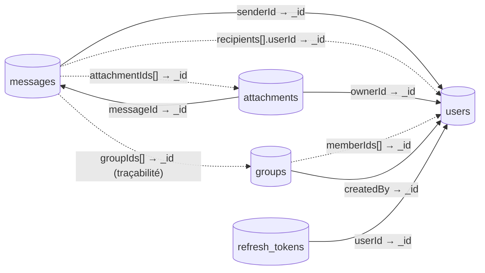

# 11 — Modèle de données MongoDB

## 1. Introduction

Ce document décrit la **modélisation NoSQL** d'ENI Mail au niveau physique : collections, structure BSON, index, contraintes, choix d'embedding vs référence, et exemples de documents réels tirés du seed.

Il complète le diagramme de classes ([03-diagramme-classes.md](03-diagramme-classes.md)) en précisant **comment** les entités sont stockées.

Base de données cible : **`eni_mail_dev`** (développement) — `eni_mail_prod` (production, suggéré).

---

## 2. Vue générale des collections

| Collection | Description | Documents typiques |
|-----------|-------------|---------------------|
| `users` | Utilisateurs (étudiants, enseignants, admin). | Petite (centaines). |
| `messages` | Messages envoyés et brouillons, avec destinataires embarqués. | Croissante (milliers). |
| `groups` | Groupes de diffusion. | Petite (dizaines). |
| `attachments` | Métadonnées des pièces jointes. | Moyenne. |
| `refresh_tokens` | Historique rotatif des refresh JWT. | Moyenne (purgé). |

### Schéma des relations inter-collections



**Trait plein** = référence requise ; **tirets** = référence par liste (multi-valeurs).

---

## 3. Collection `users`

### Schéma

```json
{
  "_id":           "ObjectId",
  "email":         "String  (unique, index, lowercase)",
  "password_hash": "String  (BCrypt)",
  "firstName":     "String",
  "lastName":      "String",
  "role":          "String  (ROLE_ETUDIANT | ROLE_ENSEIGNANT | ROLE_ADMIN)",
  "filiere":       "String? (index)",
  "promotion":     "String? (index)",
  "avatarUrl":     "String?",
  "status":        "String  (ACTIVE | DISABLED)",
  "createdAt":     "Date    (ISODate)",
  "updatedAt":     "Date    (ISODate)",
  "_class":        "String  (mg.eni.email.document.User)"
}
```

Le champ `_class` est ajouté automatiquement par Spring Data pour le polymorphisme (non utilisé ici mais présent).

### Index

| Index | Clé | Type | Rôle |
|-------|-----|------|------|
| `email_1` | `{ email: 1 }` | **unique** | Garantir l'unicité de l'identifiant de connexion. |
| `role_1` | `{ role: 1 }` | simple | Filtrer les utilisateurs par rôle. |
| `filiere_1` | `{ filiere: 1 }` | simple | Filtres d'administration. |
| `promotion_1` | `{ promotion: 1 }` | simple | Filtres d'administration. |

### Contraintes applicatives

- `email` est converti en minuscules (`email.toLowerCase()`).
- `password_hash` n'est jamais sérialisé par les DTO.
- Pas de suppression dure : `status=DISABLED` sert à « supprimer » un compte.

### Exemple (compte admin seed)

```json
{
  "_id": ObjectId("6aedce82bc3d346c13b4cca1"),
  "email": "admin@eni.mg",
  "password_hash": "$2a$12$Hz5...",
  "firstName": "Admin",
  "lastName": "ENI",
  "role": "ROLE_ADMIN",
  "filiere": "Administration",
  "promotion": "-",
  "avatarUrl": null,
  "status": "ACTIVE",
  "createdAt": ISODate("2026-11-06T12:56:34.720Z"),
  "updatedAt": ISODate("2026-11-06T12:56:34.720Z")
}
```

---

## 4. Collection `messages`

### Schéma

```json
{
  "_id":              "ObjectId",
  "senderId":         "ObjectId -> users",
  "subject":          "String (text index, poids 2)",
  "body":             "String (text index, poids 1)",
  "recipients": [
    {
      "userId":    "ObjectId -> users",
      "type":      "String  (TO | CC | BCC)",
      "read":      "Boolean",
      "readAt":    "Date?",
      "folder":    "String  (INBOX | SENT | DRAFT | TRASH)",
      "deleted":   "Boolean",
      "deletedAt": "Date?"
    }
  ],
  "senderFolder":     "String  (SENT | DRAFT | TRASH)",
  "senderDeleted":    "Boolean",
  "senderDeletedAt":  "Date?",
  "draft":            "Boolean (index)",
  "parentMessageId":  "ObjectId?",
  "threadId":         "ObjectId? (index)",
  "attachmentIds":    [ "ObjectId" ],
  "groupIds":         [ "ObjectId" ],
  "createdAt":        "Date",
  "sentAt":           "Date?"
}
```

### Justification de l'embedding `recipients[]`

L'alternative relationnelle serait une collection `message_recipients` avec une jointure `$lookup`. **Pourquoi l'embedding est préférable ici :**

1. **Lecture par acteur = lecture du document complet**. Récupérer la boîte de réception d'un utilisateur revient à un `find({"recipients.userId": uid, "recipients.folder": "INBOX"})` avec un index composé — pas de jointure.
2. **Mise à jour atomique**. Les opérateurs MongoDB `$` et `$[]` permettent de modifier **une** sous-entrée (`recipients.$.read=true`) sans lire/écrire le document entier.
3. **Taille maîtrisée**. Un `MessageRecipient` ≈ 200 octets. Même un envoi à 1 000 utilisateurs tient dans ~200 Ko, très loin de la limite BSON de 16 Mo.
4. **Cohérence** : lire le message et son état lu ensemble évite les races sur deux collections.

### Index

| Index | Clé | Type | Utilisation |
|-------|-----|------|-------------|
| `idx_recipient_folder_date` | `{ "recipients.userId": 1, "recipients.folder": 1, "sentAt": -1 }` | composé | Liste boîte de réception paginée. |
| `idx_sender_folder_date` | `{ "senderId": 1, "senderFolder": 1, "sentAt": -1 }` | composé | Messages envoyés / brouillons / corbeille expéditeur. |
| `idx_thread` | `{ "threadId": 1, "createdAt": 1 }` | composé | Reconstitution d'une conversation. |
| `senderId_1` | simple | `@Indexed` | Compteurs rapides. |
| `draft_1` | simple | `@Indexed` | Filtrage des brouillons. |
| `threadId_1` | simple | `@Indexed` | Jointures conversation. |
| Index texte | `subject` (poids 2) + `body` (poids 1) | **texte** | `/api/search`. |

### Contraintes applicatives

- Les `userId` dans `recipients` sont deux à deux distincts.
- `sentAt` est null si et seulement si `draft=true`.
- `recipients` ne peut être vide si `draft=false`.
- `attachmentIds` / `groupIds` sont des listes d'ObjectId existants au moment de l'envoi.

### Exemple — message simple

```json
{
  "_id": ObjectId("6c0..."),
  "senderId": ObjectId("6aedce82bc3d346c13b4cca2"),
  "subject": "Planning examens S1",
  "body": "Chers etudiants, veuillez trouver ci-joint...",
  "recipients": [
    {
      "userId": ObjectId("6aedce82bc3d346c13b4cca4"),
      "type": "TO",
      "read": false,
      "folder": "INBOX",
      "deleted": false
    },
    {
      "userId": ObjectId("6aedce82bc3d346c13b4cca5"),
      "type": "TO",
      "read": true,
      "readAt": ISODate("2026-11-12T08:22:11Z"),
      "folder": "INBOX",
      "deleted": false
    }
  ],
  "senderFolder": "SENT",
  "senderDeleted": false,
  "draft": false,
  "parentMessageId": null,
  "threadId": null,
  "attachmentIds": [ ObjectId("6d1...") ],
  "groupIds":      [ ObjectId("6b2...") ],
  "createdAt": ISODate("2026-11-12T08:15:00Z"),
  "sentAt":    ISODate("2026-11-12T08:15:00Z")
}
```

### Exemple — brouillon

```json
{
  "_id": ObjectId("..."),
  "senderId": ObjectId("..."),
  "subject": "WIP",
  "body": "Je reviendrai sur ce point...",
  "recipients": [],
  "senderFolder": "DRAFT",
  "senderDeleted": false,
  "draft": true,
  "parentMessageId": null,
  "threadId": null,
  "attachmentIds": [],
  "groupIds": [],
  "createdAt": ISODate("2026-11-12T08:00:00Z"),
  "sentAt": null
}
```

### Exemple — après corbeille partielle

Un destinataire a supprimé, un autre non :

```json
"recipients": [
  { "userId": "...", "folder": "TRASH", "deleted": true,  "deletedAt": "...", "read": true },
  { "userId": "...", "folder": "INBOX", "deleted": false, "read": false }
]
```

---

## 5. Collection `groups`

### Schéma

```json
{
  "_id":         "ObjectId",
  "name":        "String (unique, index)",
  "description": "String?",
  "memberIds":   [ "ObjectId -> users" ],
  "createdBy":   "ObjectId -> users",
  "createdAt":   "Date",
  "updatedAt":   "Date"
}
```

### Index

| Index | Clé | Type |
|-------|-----|------|
| `name_1` | `{ name: 1 }` | **unique** (casse insensible via code applicatif) |
| `createdBy_1` | `{ createdBy: 1 }` | simple |

### Exemple

```json
{
  "_id": ObjectId("6b2..."),
  "name": "M1 GLBD",
  "description": "Promotion Master 1 Genie Logiciel et Base de Donnees",
  "memberIds": [ ObjectId("...andria"), ObjectId("...ravelo") ],
  "createdBy": ObjectId("...admin"),
  "createdAt": ISODate("2026-11-06T13:00:00Z"),
  "updatedAt": ISODate("2026-11-07T10:30:00Z")
}
```

---

## 6. Collection `attachments`

### Schéma

```json
{
  "_id":         "ObjectId",
  "messageId":   "ObjectId? -> messages",
  "ownerId":     "ObjectId -> users",
  "filename":    "String   (nom affiche a l'utilisateur)",
  "storedName":  "String   (UUID + extension sur disque)",
  "contentType": "String   (MIME)",
  "size":        "Long",
  "createdAt":   "Date"
}
```

### Index

| Index | Clé | Type |
|-------|-----|------|
| `messageId_1` | `{ messageId: 1 }` | simple |
| `ownerId_1` | `{ ownerId: 1 }` | simple |

### Stockage physique

Le **contenu** de la pièce jointe n'est **pas** dans MongoDB mais sur le filesystem du serveur, au chemin :

```
<AttachmentProperties.storagePath>/<storedName>
```

Par défaut en dev : `./data/uploads/<UUID>.<ext>`.

Pour une migration vers **GridFS** (si > 100 Mo/fichier un jour) ou un **stockage objet** (S3 compatible), seule l'implémentation de `AttachmentService.upload/download` serait à changer — l'API REST et le modèle BSON resteraient identiques.

### Exemple

```json
{
  "_id": ObjectId("6d1..."),
  "messageId": ObjectId("6c0..."),
  "ownerId": ObjectId("...prof_rakoto"),
  "filename": "planning-s1.pdf",
  "storedName": "3fa72d42-9e6a-4f1d-bc0e-6a3c87e2f9a1.pdf",
  "contentType": "application/pdf",
  "size": 234567,
  "createdAt": ISODate("2026-11-12T08:10:00Z")
}
```

---

## 7. Collection `refresh_tokens`

### Schéma

```json
{
  "_id":       "ObjectId",
  "userId":    "ObjectId -> users",
  "tokenHash": "String (SHA-256 hex du JWT refresh)",
  "expiresAt": "Date",
  "revoked":   "Boolean",
  "createdAt": "Date"
}
```

### Index

| Index | Clé | Type |
|-------|-----|------|
| `tokenHash_1` | `{ tokenHash: 1 }` | **unique** |
| `userId_1` | `{ userId: 1 }` | simple |

### Pourquoi stocker un **hash** et pas le JWT ?

- Le JWT est signé : la validité cryptographique est vérifiée hors base.
- Le hash en base permet de **révoquer** un token : à chaque appel refresh, on cherche le hash et on vérifie `revoked=false`.
- Si la base fuite, l'attaquant ne récupère pas les tokens utilisables (pré-image SHA-256 impossible).

### Nettoyage (recommandé)

Ajouter en V2 un **TTL index** sur `expiresAt` pour purger automatiquement :

```js
db.refresh_tokens.createIndex({ expiresAt: 1 }, { expireAfterSeconds: 0 });
```

---

## 8. Récapitulatif des index — déclaration via Spring Data

| Collection | Déclaration | Source |
|-----------|-------------|--------|
| `users` | `@Indexed(unique=true)` sur `email`, `@Indexed` sur `filiere`, `promotion` | [User.java](../../eni-mail-back/src/main/java/mg/eni/email/document/User.java) |
| `messages` | `@CompoundIndexes` + `@TextIndexed` + `@Indexed` | [Message.java](../../eni-mail-back/src/main/java/mg/eni/email/document/Message.java) |
| `groups` | `@Indexed(unique=true)` sur `name` | [Group.java](../../eni-mail-back/src/main/java/mg/eni/email/document/Group.java) |
| `attachments` | `@Indexed` sur `messageId`, `ownerId` | [Attachment.java](../../eni-mail-back/src/main/java/mg/eni/email/document/Attachment.java) |
| `refresh_tokens` | `@Indexed(unique=true)` sur `tokenHash`, `@Indexed` sur `userId` | [RefreshToken.java](../../eni-mail-back/src/main/java/mg/eni/email/document/RefreshToken.java) |

L'auto-création des index est pilotée par :

```yaml
spring.data.mongodb.auto-index-creation: true
```

---

## 9. Volumes estimés (hypothèse H1)

| Collection | Volume cible V1 | Taille moyenne doc | Volume total |
|-----------|-----------------|---------------------|---------------|
| `users` | 500 | 400 B | ~0,2 Mo |
| `messages` | 10 000 | 5 Ko (dont destinataires) | ~50 Mo |
| `groups` | 20 | 1 Ko | ~20 Ko |
| `attachments` (métadonnées) | 2 000 | 500 B | ~1 Mo |
| `refresh_tokens` | 500 actifs | 300 B | ~150 Ko |
| **Total MongoDB** | | | **~51 Mo** |
| Filesystem PJ | 2 000 × 500 Ko moy. | | **~1 Go** |

Dimensionnement très confortable sur une VM 2 vCPU / 2 Go RAM.

---

## 10. Suite

→ [12-diagramme-architecture-generale.md](12-diagramme-architecture-generale.md) — vue synthétique de l'ensemble.
