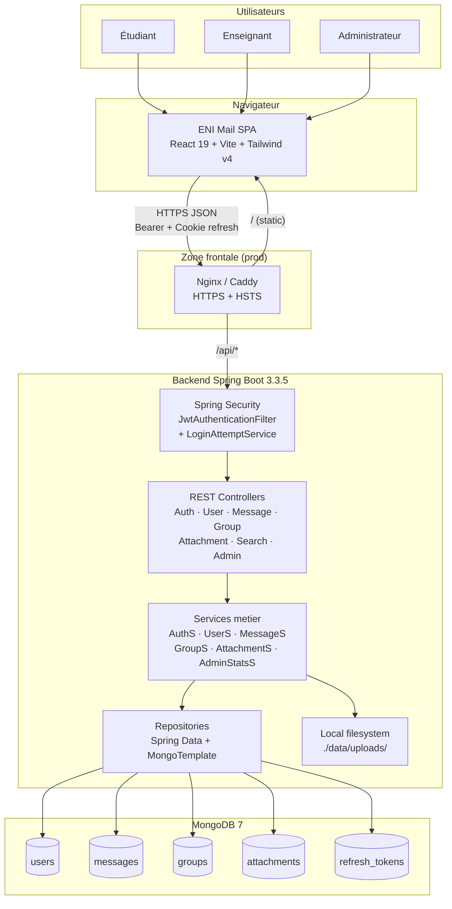
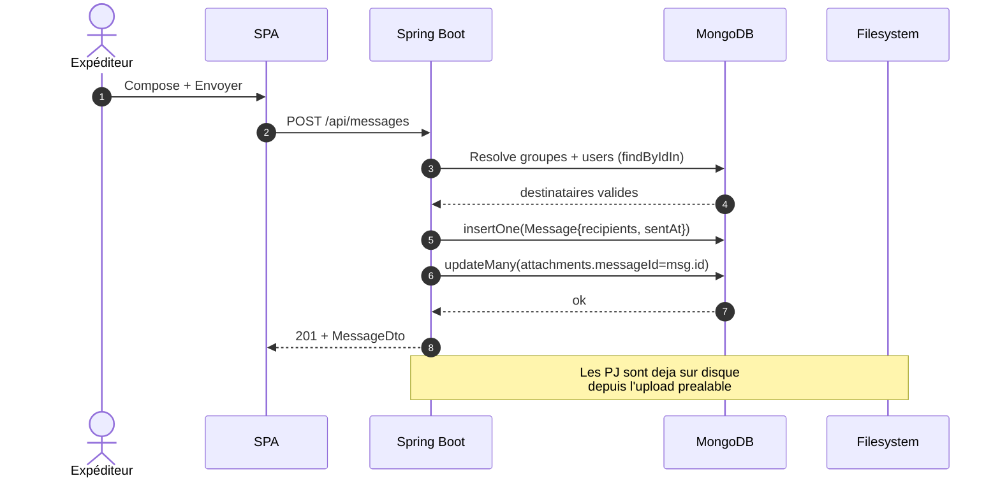
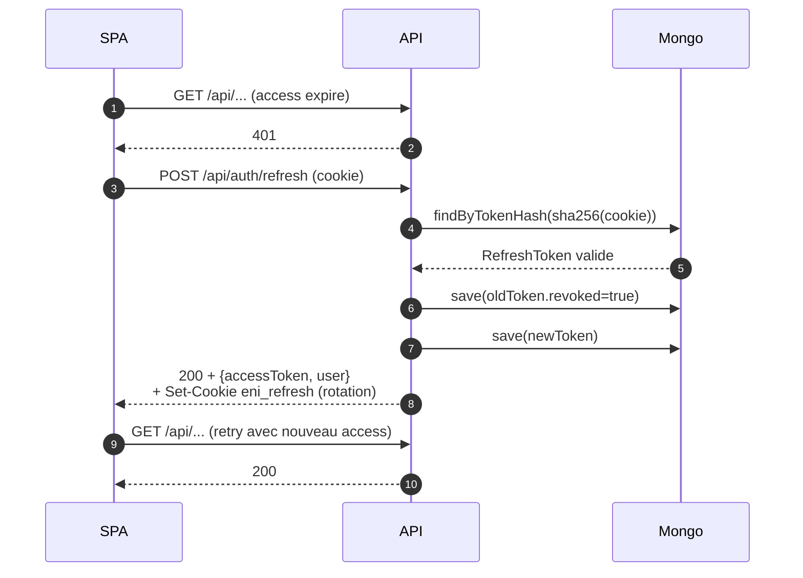
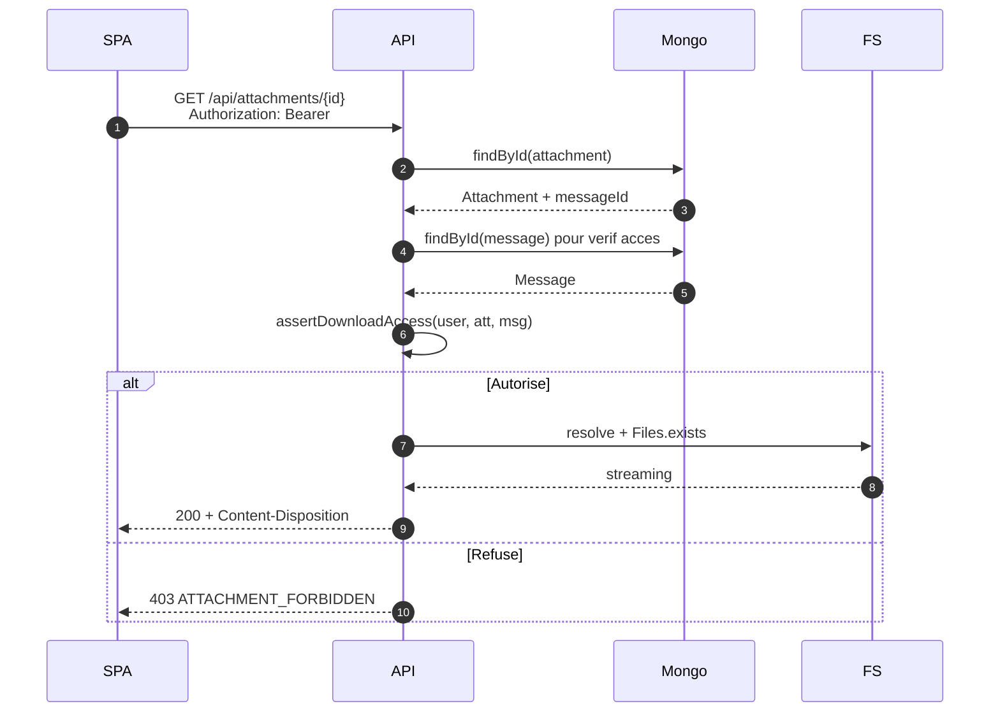
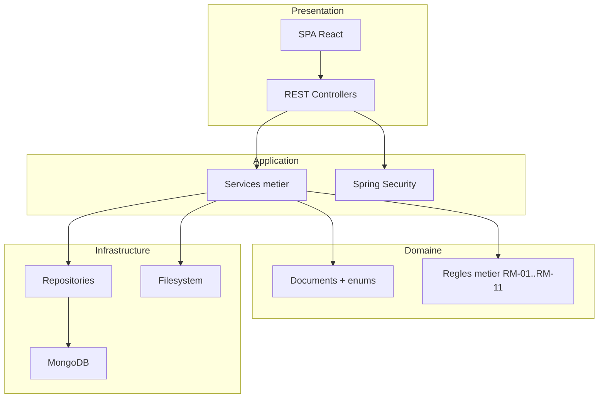

# 12 — Diagramme d'architecture générale

## 1. Introduction

Ce document fournit une **vue synthétique** du système ENI Mail, utile pour une présentation en comité technique ou une soutenance. Il consolide les informations détaillées dans les fichiers précédents (8, 9, 10) en une seule planche.

---

## 2. Vue d'ensemble

---

## 3. Flux de données clés

### 3.1. Flux « Envoi d'un message »

### 3.2. Flux « Rafraîchissement de session »

### 3.3. Flux « Téléchargement d'une pièce jointe »

---

## 4. Vue en couches

---

## 5. Sécurité — défense en profondeur

| Couche | Mécanisme |
|--------|-----------|
| Transport | HTTPS + HSTS (prod). |
| CORS | Origines explicites (pas de wildcard). |
| Authentification | JWT HS256 (access 15 min) + refresh HttpOnly rotatif. |
| Mot de passe | BCrypt facteur 12. |
| Anti-bruteforce | `LoginAttemptService` (5 essais / 15 min). |
| Autorisation | `@PreAuthorize` + vérifications métier par ID dans les services. |
| Validation entrées | Jakarta Bean Validation (`@NotBlank`, `@Email`, `@Size`). |
| Protection path traversal | Normalisation + `path.startsWith(root)` dans `AttachmentService`. |
| MIME whitelist | Liste fermée dans `application.yml`. |
| Erreurs | Pas de stack trace renvoyée au client, code applicatif + message FR. |

---

## 6. Technologies et versions

| Couche | Technologie | Version | Rôle |
|--------|-------------|---------|------|
| Frontend | React | 19.3.x | UI SPA. |
| Frontend | Vite | 8.3.x | Build + dev server. |
| Frontend | TypeScript | 6.0.x | Typage statique. |
| Frontend | Tailwind CSS | 4.3.x | Design system. |
| Frontend | React Router | 7.18.x | Routage SPA. |
| Frontend | React Query | 5.106.x | Cache serveur. |
| Frontend | React Hook Form + Zod | 7.91.x + 3.x | Formulaires validés. |
| Frontend | Sonner | — | Toasts. |
| Frontend | date-fns | — | Dates (locale FR). |
| Frontend | Lucide React | 1.70.x | Icônes. |
| Backend | Java | 17+ (testé 21) | Runtime. |
| Backend | Spring Boot | 3.3.5 LTS | Framework. |
| Backend | Spring Security | 6.3.x | Auth + autorisations. |
| Backend | Spring Data MongoDB | — | ORM NoSQL. |
| Backend | JJWT | 0.12.6 | JWT HS256. |
| Backend | Lombok | — | Boilerplate. |
| Base | MongoDB | 7 | Persistance. |

---

## 7. Volumétrie et performance cibles

| Indicateur | Valeur |
|-----------|--------|
| Utilisateurs enregistrés | 100 à 500 |
| Utilisateurs simultanés | 100 |
| Messages par campagne | 100 à 1 000 |
| Temps de réponse p95 | < 2 s |
| Disponibilité | > 99 % |
| Taille PJ max | 5 Mo |

---

## 8. Points forts et limites de l'architecture V1

### Points forts

- Séparation stricte front/back + API REST contractée.
- Modèle NoSQL optimisé pour les lectures de boîte de réception.
- Sécurité en profondeur, pas de délégation au front.
- Code typé bout-en-bout (TypeScript côté SPA, Java fortement typé côté backend).
- Tests unitaires (JwtService, LoginAttemptService) + harness d'intégration prévu.
- Documentation UML exhaustive.

### Limites connues (V1)

- Pas de notifications push.
- Pas de nettoyage automatique des pièces jointes orphelines après suppression définitive.
- Pas d'historique d'audit sur les actions administrateur.
- Rate-limit en mémoire (non partagé entre instances — refactor Redis en V2).
- Pas encore de job de rotation des refresh tokens révoqués (TTL index à ajouter).

---

## 9. Suite

→ [13-matrice-tracabilite.md](13-matrice-tracabilite.md) — validation exhaustive de la couverture des exigences.
